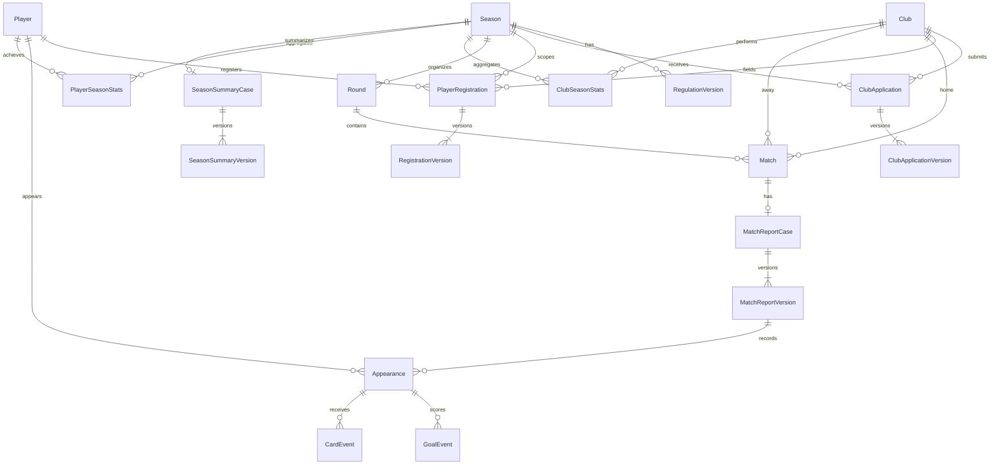
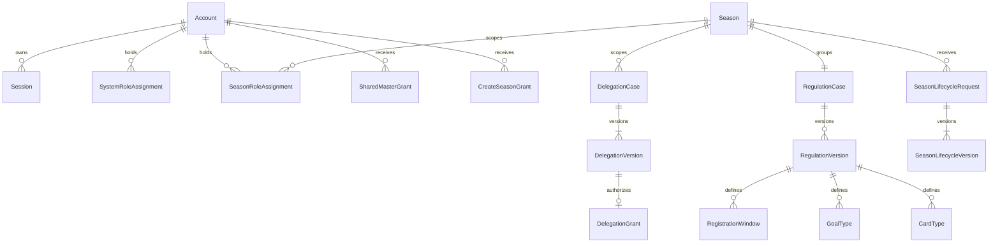
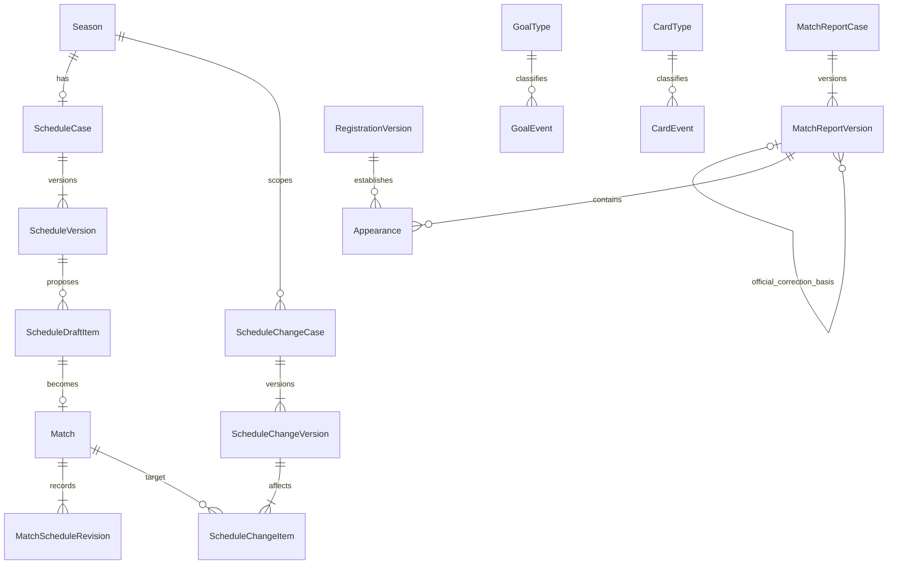
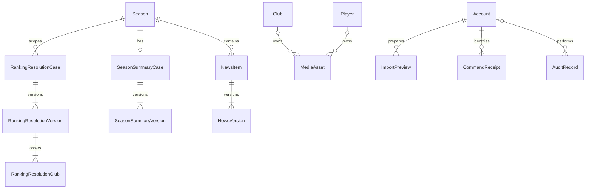

# Architecture and shared technical contracts

Owns approved stack, layering, time representation and final write authorization. Only the decisions below are selected; D079 owns module responsibilities/coordination, while D080 defines session transport/storage/expiration; D082 defines relational foundations and D087 the reference deployment; D095/D096 now provide the typed dictionary, interfaces and security/execution contracts, and D097 the selected toolchain/development/operations baseline. Runtime verification and operator inputs remain outstanding. See [open work](../open-decisions.md).

### D001 - Modular, layered monolithic backend

**Confirmed policy.** [Approval, source and rationale](../../docs/adr/0001-modular-layered-backend.md#d001-english-evidence).

- **Source:** O12; CN-01-CN-04, PDF p.26; centralized data constraint in §1.2.6.1; three-member team and source project plan in §1.5 pp.50-52.

- **Decision:** One backend deployed as a single unit, organized into business modules with clear request-handling, business-processing and data-access responsibilities; one centralized relational database.

### D002 - Approved technology stack and API style

**Confirmed policy.** [Approval, source and rationale](../../docs/adr/0002-approved-technology-stack.md#d002-english-evidence).

- **Source:** O12; CN-01-CN-04, PDF p.26; Q2 confirmation. The selection principle prioritizes technologies the team has practiced, subject to course constraints. The confirmation does not establish individual members' experience or additional course constraints.

- **Decision:** Frontend: React + TypeScript. Backend: NestJS + TypeScript. Database: PostgreSQL. ORM: Prisma ORM. API style: REST API. Architecture: Modular Monolith combined with Layered Architecture, consistent with [D001](architecture.md#d001---modular-layered-monolithic-backend).

- **Consequences:** Chapter 3 design and subsequent implementation planning use this approved stack. Module ownership follows [D079](#d079---backend-module-ownership-and-synchronous-coordination); PostgreSQL schema, Prisma mappings, detailed internal interfaces and REST contracts must be designed consistently with it.

### D024 - UTC instants and a single Vietnam display/input time zone

**Confirmed policy.** [Approval, source and rationale](../../docs/adr/0006-utc-instants-and-vietnam-time-zone.md#d024-english-evidence).

- **Source:** O03/O12 and cross-cutting O07/O08; TT-04, PDF p.19; time-related scheduling/registration/regulation/delegation requirements. This is an explicitly confirmed v2 design policy, not a time zone specified by the PDF.

- **Decision:** Store and compare exact instants using UTC. Use Asia/Ho_Chi_Minh consistently for time entry and display across the system, including match schedules, registration deadlines, regulation/delegation effectivity and activity history. Clearly label the time zone and do not automatically switch to the user's device time zone.

- **Date-only values:** Preserve dates without a time component, such as dates of birth and U21 birth-date cutoffs, as calendar-date values without time-zone conversion. This does not select the actual seasonal cutoff dates or deadline values.

### D030 - Recheck current session and authority at the final decision point of writes

**Confirmed policy.** [Approval, source and rationale](../../docs/adr/0007-final-authorization-check-for-writes.md#d030-english-evidence).

- **Source:** O07/O08/O12; BM-01/BM-02 and CN-02, PDF pp.23/26; AT-02/AT-03, p.32; [D007](../use-cases/administration.md#d007---invalidate-sessions-after-permission-changes-or-account-locking)/[D020](access-control.md#d020---terminate-delegation-permanently-when-required-eligibility-is-lost)-[D023](access-control.md#d023---explicit-delegation-startend-instants-with-an-exclusive-end).

- **Decision:** For internal write operations, check permission when receiving the request and recheck the current session, authority and validity period at a final decision point inside the transaction before successfully recording the change. Starting with valid permission is insufficient if the session/authority is no longer valid at that final point.

- **Synchronization:** [D084](#d084---revision-checks-idempotent-commands-and-targeted-transaction-locks) owns the approved revision/idempotency/Read Committed locking and retry policy.

- **Failure and consistency:** If the final check fails, reject and roll back that business transaction without partial business data, statistics or workflow-state changes. Permission revocation and concurrent writes must have a consistent order so an old permission check cannot write past a revocation already in effect. Previously valid completed operations remain unchanged; revocation does not undo them retroactively.

- **Boundary example:** A request received at 11:59:59 using authority expiring at 12:00 must fail if its final authorization check occurs at 12:00:01. The interval boundary is as confirmed in [D023](access-control.md#d023---explicit-delegation-startend-instants-with-an-exclusive-end).

### D079 - Backend module ownership and synchronous coordination

**Status:** CONFIRMED by the Team Leader, Q79 option A and the full proposed package. [Approval and rationale](../../docs/adr/0001-modular-layered-backend.md#q79---module-ownership-and-coordination).

| Module | Owned responsibilities |
|---|---|
| Identity & Access | UC01-UC04; accounts, sessions, permissions, assignments and delegation |
| Season & Regulations | UC05-UC06; seasons, regulation versions, closure/reopening |
| Registry & Registration | UC07-UC11; club/player masters, registration and transfers |
| Scheduling | UC12-UC15; stadiums, fixture schedules, adjustments and postponement |
| Match Results | UC16-UC19; reports, appearances, events, result confirmation/correction |
| Statistics & Reporting | UC20/UC22; standings, achievements, ranking resolutions and season summaries |
| Public Queries | UC21/UC23 and Dashboard; permitted read aggregation |
| News | UC24-UC25; content, publication versions and withdrawal |

- **Write ownership:** A data group has one business module responsible for validating and changing it. Other modules call its provided functions rather than writing its data to bypass rules.
- **Synchronous coordination:** Coordinate use cases through explicit internal calls in the single backend. No message broker or distributed-event mechanism is required by this design.
- **Transaction boundary:** A use-case application layer coordinates changes requiring consistency in one PostgreSQL transaction, including result confirmation/correction, statistics and history under D030/D063. Any failure rolls back the complete operation.
- **Dependencies:** Keep use-case orchestration separate from component business functions to avoid circular dependencies. Match Results provides valid result data; Statistics & Reporting calculates from that basis; orchestration completes the consistent operation. Exact internal interfaces/dependency details remain for technical design.
- **Read consistency:** Public Queries/Dashboard reuse the approved statistical results and publication rules rather than calculating a separate standings/achievement interpretation.
- **Shared support:** Media, Audit and Data Exchange support the owning modules without taking over their business authority/validation. Use one PostgreSQL with Prisma and retain the approved layered responsibilities. This adds no independently deployed service, library or infrastructure selection.

### D080 - PostgreSQL server-side sessions with protected cookies

**Status:** CONFIRMED by the Team Leader, Q80 option A and its full proposed package. [Approval and rationale](../../docs/adr/0019-postgresql-cookie-sessions.md).

- **Server-side state:** PostgreSQL stores the account association, creation/activity/expiration times and revocation state. The browser holds only a random opaque session token, not business authority claims used to decide access. Store a hash of the session token rather than a directly reusable token.
- **Cookie/transport:** Use HttpOnly and SameSite=Lax cookies, with Secure on the HTTPS deployment. Do not store the token in localStorage/sessionStorage. Successful login creates a new session token.
- **Deployment origin:** Serve frontend and REST API through the same origin, with an API path such as /api. D087 subsequently selects Caddy for the reference deployment; no hosting provider is selected.
- **CSRF:** Protect state-changing browser requests with CSRF tokens and appropriate origin validation; SameSite is an additional layer, not the entire defense. Detailed contracts must cover login/logout too.
- **Expiration:** Server-enforced expiration is 30 minutes without a valid authenticated internal request, or 8 hours from login, whichever occurs first. There is no remember-me option in the first version.
- **Concurrent sessions/logout:** Permit multiple sessions for an account across browsers/devices. Ordinary logout revokes the current session and clears its cookie. D007/D022/D039/D076 events still invalidate all applicable sessions.
- **Current authority:** Session validity alone grants no business action. Check current role, season, delegation and business state, retaining final in-transaction permission/session validation under D030.
- **Feedback:** Expiration requires login again; account/permission-triggered invalidation uses the D007 notice. Do not automatically replay writes that could execute twice.
- **Remaining contracts:** Token/hash/cookie/CSRF/security-state and error/concurrency contracts now follow [D096](#d096---api-execution-synchronized-csrf-and-transaction-contracts); environment/library selections now follow D097; exact patch pins and executed verification remain PHASE 1 work. No JWT/refresh-token mechanism, Redis or session library is selected by this decision. Password hashing/lifecycle is separately selected by [D081](../use-cases/administration.md#d081---password-hashing-and-managed-credential-lifecycle).

### D082 - Relational identity, version and snapshot foundations

**Status:** CONFIRMED by the Team Leader, Q82 option A and its full common package. [Approval and rationale](../../docs/adr/0021-relational-identifiers-and-snapshots.md).

- **Identifiers:** Use backend-generated UUID v4 technical identifiers for independently identified entities, stored as PostgreSQL uuid and represented as strings in APIs. Business codes remain separate, unique/stable/nonreusable under D058; relationships do not use editable descriptive fields as keys.
- **Normalization:** Represent core seasons, clubs, players, registrations, matches, report versions, appearances, goals and cards with explicit relational tables and appropriate foreign keys/constraints. Do not replace complete core profiles/reports with JSON documents.
- **Cases and versions:** Versioned business workflows have a stable case and numbered content versions within it. Content/approval links identify the exact version rather than an implicitly mutable latest record.
- **Selective snapshots:** Use JSONB for the already-required historical snapshots and before/after audit payloads, with defined validated structures. Keep relationships, states, effective intervals and fields needed for business constraints in explicit columns/tables.
- **Types:** Use timestamptz for exact instants and date for birth dates/U21 cutoff dates under D024. Counts, goals, minutes and shirt numbers use integers with their applicable constraints.
- **Preservation:** Block master deletion or destructive cascading deletion that loses used registrations, results or history. Draft/temporary-data cleanup has a separate scope and cannot remove submitted/approved versions.
- **Design boundary:** The D095 detailed dictionary below elaborates entity/field/key/index/deletion design under these foundations and the approved domain rules; this is no migration, code implementation or whole-package approval.

## Derived relational model map

This initial map was derived from approved D001-D082 and remains the short entry view. The [D095 detailed dictionary](#detailed-relational-dictionary) now elaborates table/column/key/index mappings; no physical schema has been implemented. Cardinalities are read with draft completeness and approval-milestone constraints in the owning UC documents. Statistical projection storage/recalculation follows [D083](../use-cases/results.md#d083---stored-official-statistics-with-full-season-recalculation).

| Owner under D079 | Entity families and relationships | Rule basis |
|---|---|---|
| Identity & Access | One personal account per person; an account has many sessions and seasonal role assignments; separately scoped permission grants; delegation proposal versions and granted authority remain distinct | D003-D041, D076, D080-D081 |
| Season & Regulations | A season has many immutable regulation versions, their registration windows and applicable goal/card catalog entries; preserve cancellation/replacement and lifecycle history | D042-D054, D072, D074, D076 |
| Registry & Registration | Shared Club/Player masters; one club-season application case with versions; player registrations linked to player/club/season and their versioned playing intervals/verification basis; preserve prior-transfer dependencies | D035-D036, D055-D059, D075 |
| Scheduling | Stadium master; version-owned draft items distinct from stable Match records created at initial approval under [D093](../use-cases/scheduling.md#d093---deterministic-fixture-generation-and-stable-published-match-identity); season rounds and home/away clubs; schedule versions and entries; versioned adjustment/postponement requests with affected items | D060-D062, D067 |
| Match Results | One report case per match with versions; appearances/goals/cards belong to the report version; current Official Result refers to a confirmed report version, while pending corrections do not replace it | D047-D049, D063-D065 |
| Statistics & Reporting | ClubSeasonStats and PlayerSeasonStats derived from current Official Results under D083; ranking-resolution cases/versions and ordered clubs; one season-summary case with immutable confirmed versions and selective source snapshots | D066, D070-D073, D083 |
| Public Queries | Reads permitted source records and shared statistical interpretation; Dashboard is not another authoritative competition dataset | D032-D033, D068, D079 |
| News | Each news item belongs to one season and has content versions, an explicitly permitted current publication and retained withdrawal/publication history | D077 |
| Shared support | Media metadata/current club/player references plus environment-selected durable file/object storage under [media policy](media.md#environment-specific-media-storage); actor-linked audit entries with selective JSONB; account/action-scoped command receipts; XLSX creates existing master entities without new approval bypasses | LOGO-01, D069, D078, D082, D084 |

### Core competition relationships

The diagram deliberately shows only the competition core; [D095 dictionary and supporting ERDs](#detailed-relational-dictionary) provide the remaining families and draft-nullability/key/deletion design.

A scheduled match can exist before report entry; a MatchReportCase is created when report preparation starts, not by treating scheduling as result creation. Appearance/event completeness is required at the D064/D065 submission/confirmation milestones. The current official-version reference is distinct from the version-history relationships shown.

### D084 - Revision checks, idempotent commands and targeted transaction locks

**Status:** CONFIRMED by the Team Leader, Q84 option A and its full common package. [Approval and rationale](../../docs/adr/0022-targeted-locks-and-idempotent-commands.md).

- **Optimistic revision:** Editable records/aggregates carry a technical revision separate from D082 content-version numbering. Mutations provide the revision read; stale revisions are rejected for reload/review rather than silently overwriting another writer.
- **Submitted content:** Approval/confirmation targets the exact submitted content version and still-valid basis. Changed prerequisites cause a conflict/review, not automatic approval of newer content.
- **Idempotency:** Critical commands, including approvals, result confirmation/correction, transfers, season closure/reopening and import commit, carry a unique request key. Persist a receipt in PostgreSQL in the same transaction as the business change.
- **Receipt semantics:** For 24 hours, the same account/action/key and content return the recorded outcome without a second execution; key reuse with changed content is rejected. Validate current session and access before returning stored data. After receipt retention expires, business state/version constraints still prevent repeated sporting operations.
- **Final authorization/time:** Writes and permission changes/revocation use consistent synchronization under D030. Recheck actual validity at the final decision point, including after waiting for locks.
- **Isolation/locks:** Use Read Committed with explicit targeted synchronization: season locks for D083 result/statistics transactions; relevant shared club/stadium resources for cross-season scheduling; player/squad resources for interval/limit checks; authorization-change coordination plus separate bootstrap/last-administrator guards. Specify one lock-acquisition order and retain database constraints as final protection.
- **Bounded retry:** At most three total server execution attempts for transient transaction errors known to have rolled back, with all checks repeated. Do not automatically retry authorization, invalid-data or stale-revision errors. If commit outcome is unknown, look up the receipt before considering another execution.
- **Remaining contracts:** Guard groups/lock order, receipt key/digest/error behavior and per-UC execution matrices now follow [D096](#d096---api-execution-synchronized-csrf-and-transaction-contracts); exact SQL/timeout/cleanup configuration remains implementation-plan elaboration. This selects no Redis/broker, implementation or blanket Serializable policy.

### D085 - Shared REST transport and response contract

**Status:** CONFIRMED by the Team Leader, Q85 option A and its full common package. [Approval and rationale](../../docs/adr/0023-shared-rest-contract.md).

- **Routes/methods:** Prefix routes with /api/v1. GET reads; POST creates or executes explicit business commands; PATCH edits allowed fields. Submit/approve/confirm/withdraw actions have explicit endpoints; a generic status PATCH cannot bypass workflows.
- **Values:** Use JSON UTF-8 and camelCase fields, string UUIDs, ISO 8601 UTC instants ending in Z and YYYY-MM-DD date-only values under D024/D082.
- **Validation:** Per-operation server-side field allowlists reject unknown fields and invalid types/values. Do not expose one unrestricted update payload across roles/states.
- **Lists:** Use page/pageSize with default 20 and maximum 100, return total item count, and allowlist filters/sorts with deterministic ordering. D066 sporting rank/tie rules still apply.
- **Concurrency/tracing:** Mutations identify required technical revisions/content versions and D084 idempotency keys. A requestId traces one HTTP attempt and is not its business idempotency key.
- **Responses:** JSON successes use { data, meta?, requestId }; failures use { error: { code, message, details? }, requestId }. Codes are stable; details identify permitted validation fields or XLSX rows/columns when appropriate. Never expose passwords, hashes, SQL or stack traces.
- **HTTP mapping:** 200/201 success/creation; 400 invalid input; 401 invalid/missing session; 403 valid session but disallowed; 404 absent/non-discoverable resource; 409 revision/state/data/idempotency conflict; 413 oversized file; 415 unsupported media type; 429 request throttling; 500 unexpected failure; 503 temporary unavailability. Failed business actions do not return HTTP 200.
- **Access/files:** Classify public/internal endpoints and filter fields on the server. Media/XLSX downloads return file bytes with the appropriate content type, outside the JSON envelope; error handling must preserve access boundaries.
- **Remaining work:** Read per-UC route/DTO maps with [D096](#d096---api-execution-synchronized-csrf-and-transaction-contracts) shared security/error/lock rules and the owning execution matrices; remaining runtime/library and deployment parameters stay in the open register. This selects no generated client, validation/HTTP library or implementation.

### D086 - React SPA tooling and shared UI approach

**Status:** CONFIRMED by the Team Leader, Q86 option A and its full common package. [Approval and rationale](../../docs/adr/0024-react-frontend-tooling-and-ui.md).

- **Tooling:** Build the React/TypeScript SPA with Vite and React Router. Use Ant Design for standard components and CSS Modules for layout/league-specific styling. Select compatible versions with the development environment; this creates no code or dependency installation now.
- **Language/time:** The first-version UI is Vietnamese, preserving appropriate proper club/player names and terms. Context documentation stays English-only. Display/input uses D024, not automatic device-zone switching.
- **Navigation:** Public screens cover Dashboard, club/player profiles, schedule/results, standings/achievements and news. Internal screens expose authorized business functions in one application, with relevant season selection for multi-role users. Global account administration does not require a seasonal business role.
- **API/state:** Use one Fetch-based API layer for cookies/CSRF, D085 replies/errors/pagination and D084 command keys. Use React state/hooks/context for UI/session state; no separate state/cache library is required by this package.
- **Interactions:** Provide Loading/Empty/Error, field errors, result feedback and important-action confirmations. Approval views identify preparers, version and required reasons rather than offering an unexplained status toggle.
- **Conflicts/session loss:** On 409 preserve current input for review instead of overwriting. On loss of internal session validity, clear internal in-memory data and require login under D080/D081; do not restore that data to another account.
- **Visual/access consistency:** Share visual tokens, tables/forms and managed media/fallback components under TT-02/D068. Frontend access checks support navigation; the backend remains authoritative. Exact routes/layout details are derived from the existing UCs, not new actors or UCs.

## Derived frontend screen map

Derived from D068/D074-D086 and the owning UCs, this is a navigation/layout design map rather than implemented screens or new feature Specifications. Browser routes below differ from /api/v1 API routes. Exact artwork and component layout remain design elaboration under D086 and existing quality criteria.

| Area/browser route family | Screens and actions | Governing scope |
|---|---|---|
| / and /seasons/{seasonId} | Public season selection and D068 overview | Published/permitted data; no separate internal work-queue dashboard |
| /seasons/{seasonId}/clubs and /players | Searchable/paginated lists and club/player details | UC23; D032, seasonal snapshots, LOGO-01/D069 |
| /seasons/{seasonId}/schedule and /matches | Published fixtures, explicit postponed state, match details and Official Results | UC15/UC21; D063/D067 |
| /seasons/{seasonId}/standings and /statistics | Shared ranks, scorers/clean-sheet leaders and full-list navigation | UC20 public output/UC23; D066/D070/D083 |
| /seasons/{seasonId}/news | Current published news list/detail | UC25; D077 |
| /login and /change-password | Login and restricted required-password-change state | UC01; D080/D081 |
| /workspace/accounts and /audit | Account/permission/session-related administration and audit search | UC03/UC04; global rights and redacted fields |
| /workspace/seasons | Create Season action and assigned-season management/closure/reopening | UC05; D074/D076 |
| /workspace/seasons/{seasonId}/regulations | Version drafts, exact submitted-version review and approvals/effectivity | UC06; D042-D054/D072 |
| /workspace/clubs and /players | Authorized master profiles/media and D078 exchange entry points | UC07/UC09; separately granted master rights |
| /workspace/seasons/{seasonId}/registrations | Club applications, player registrations, eligibility reasons, transfers and corrections | UC08/UC10; UC11 inline validation, not an independent public service |
| /workspace/stadiums and /workspace/seasons/{seasonId}/schedules | Stadium masters, initial schedule drafts, adjustment/postponement requests and approvals | UC12-UC14; D060-D067 |
| /workspace/seasons/{seasonId}/results | Report editing, appearance/event/referee basis, confirmation and correction review | UC16-UC19; UC20 is internal recalculation, not a manual statistics editor |
| /workspace/seasons/{seasonId}/reports | BM5 previews/XLSX exports, playoff ranking-resolution cases and versioned summaries | UC22; D070-D073/D078 |
| /workspace/seasons/{seasonId}/news | Draft/revision, self-publication, withdrawal and retained history | UC24; D077, including its Closed-season exception |

The internal shell is a permission-aware menu/workspace, not an additional mandatory Dashboard. Components reuse the same metadata, date/time and API adapters; no client-maintained authoritative standings or permission store is introduced. All screen groups retain the source empty/error/unauthorized/confirmation paths, and ineligible self-approval remains server-rejected even if a client route is accessed directly.

### D087 - Docker Compose reference deployment

**Status:** CONFIRMED by the Team Leader, Q87 option A and the full common package, with the explicitly approved optional Supabase Storage amendment. [Approval and rationale](../../docs/adr/0001-modular-layered-backend.md#q87---docker-compose-reference-deployment).

- **Reference topology:** One Linux host runs the single NestJS backend, PostgreSQL and Caddy through Docker Compose with an internal service network. Caddy serves the React production build and reverse-proxies /api/v1 to the backend under the same browser origin. This retains the modular layered monolith; no hosting provider or purchased domain is selected.
- **HTTPS:** Use valid HTTPS for deployment and D080 Secure cookies. A local HTTPS acceptance setup must establish appropriate certificate trust to exercise those controls; development configuration is separate. Persist Caddy certificate state across container replacement.
- **Durability:** PostgreSQL data uses persistent volumes outside the repository/executable area. Media follows the single owning [environment-specific storage policy](media.md#environment-specific-media-storage), including local persistent volumes or the permitted Internet alternative. Application/container restart or replacement must preserve persisted data. Persistence alone does not establish backup/recovery.
- **Environment and secrets:** Separate development, test and acceptance configuration/data. Keep credentials and secrets outside Git; committed configuration examples contain placeholders only. Initial administrator setup remains D008's server CLI, not default credentials or a public bootstrap endpoint.
- **Repeatable operation:** Document prerequisites, build, migration, start and health verification. Pin compatible versions when establishing the toolchain. Migrations must preserve existing data rather than silently reset/delete it. Exact versions, host sizing and operation scripts remain elaboration, not selected products in this decision.
- **Boundaries:** Core business remains independent of external football APIs. The storage amendment does not select Vercel, Render, Supabase Database or Supabase Auth, change D080 authentication, or authorize current API integration/code implementation. Backup/restore follows D088 below; timed-job mechanisms follow D089 below and detailed operational configuration remains open under existing quality thresholds; no whole-v2 or Phase completion is implied.

Technical references: [Docker Compose application model](https://docs.docker.com/compose/intro/compose-application-model/), [Docker volume persistence](https://docs.docker.com/engine/storage/volumes/) and [Caddy automatic HTTPS](https://caddyserver.com/docs/automatic-https). These explain the selected mechanisms, not additional project policy.

### D088 - Coordinated backup sets and controlled restore

**Status:** CONFIRMED by the Team Leader, Q88 option A and the full proposed package ("Tôi chọn A."). [Approval and rationale](../../docs/adr/0001-modular-layered-backend.md#q88---coordinated-backup-and-restore). This elaborates D087/LOGO-01/D069 and BM-07; it does not establish implementation or acceptance.

- **Backup unit:** One complete set contains a PostgreSQL custom-format pg_dump archive, the actual referenced media files/objects from the configured storage, and a manifest with set identifier, timestamp, schema/application versions and image inventory/checksums. Restore PostgreSQL through pg_restore. No simultaneous local/remote operational media stores are required.
- **Consistent boundary:** Enter write-maintenance mode, stop admitting new writes and wait for in-flight operations to complete before establishing the backup point. This covers business writes, media replacement/removal and background writers. Reads may continue where safe, with clear maintenance feedback. Publish a set as successful only after database, media and manifest are complete and verified.
- **Execution and failure:** Automatically back up at least once every 24 hours, with additional operator-initiated runs before migrations or important changes. Prevent overlapping runs. Record failed runs and notify the operator; permit rerun. Failed/incomplete sets do not replace good sets or count toward retention. The scheduling mechanism is owned by [D089](#d089---periodic-jobs-and-overdue-regulation-activation).
- **Storage and retention:** Keep backup sets separate from live data directories, Git and public web paths, with restricted access. Internet deployments require a copy outside the application host. Retain at least the 7 most recent complete sets. Cleanup must preserve image content required by retained sets. Manage credentials separately; do not include them in manifests/logs. Exact destination, paths and provider-specific transfer/configuration are subsequent technical elaboration, not a selected new service.
- **Restore authority and procedure:** Restore through an operator-controlled server procedure/command, not a public restore API/page. Keep write maintenance active; restore database and media from the same set. Check schema compatibility, relationships, image references and important business functions before reopening. Invalidate restored login sessions and require fresh login rather than reviving old sessions.
- **Verification and limits:** Rehearse on a separate environment with the selected storage profile's season data/media, demonstrate the existing 30-minute full-season recovery threshold and test incomplete/corrupt media sets. Recovery returns to the selected backup point; no point-in-time-per-transaction recovery or zero-loss promise is added. Existing BM-07 thresholds remain unchanged. Detailed scripts, checks and runbooks are implementation-planning work; whole-v2 approval is recorded through Q98; Phase acceptance remains unverified.

Technical references: [PostgreSQL pg_dump](https://www.postgresql.org/docs/current/app-pgdump.html) and [pg_restore](https://www.postgresql.org/docs/current/app-pgrestore.html) describe the selected database tools. [Supabase backup scope](https://supabase.com/docs/guides/platform/backups) explains why actual Storage objects must be included separately. D088's write-maintenance boundary coordinates database and media; a database dump alone does not establish that cross-store boundary.

### D089 - Periodic jobs and overdue regulation activation

**Status:** CONFIRMED by the Team Leader, Q89 option A and the entire proposed package ("Tôi chọn A."). [Approval and rationale](../../docs/adr/0001-modular-layered-backend.md#q89---periodic-jobs-and-overdue-activation). This owns scheduling/technical recovery; [D051](../use-cases/registration.md#d051---controlled-cancellation-replacement-and-activation-of-waiting-regulations) retains ownership of regulation cancellation/replacement and business-incompatible activation.

- **Execution model:** Use @nestjs/schedule within the existing backend for business jobs, and Linux systemd timers for operator-run backup commands under D088. Do not add Redis, a message broker or an independently deployed worker service. Exact runtime/package versions and timer/service definitions remain toolchain elaboration.
- **Due-work discovery:** Scan waiting regulation versions every 1 minute while the backend runs. At backend startup, discover overdue work from persisted PostgreSQL state and catch up. Reuse owning business services/transactions rather than maintaining separate timer-only business rules.
- **Time correctness:** Preserve the approved effective instant separately from actual processing time. A late timer does not move effectivity to its execution time or rewrite historical decisions. Before an operation relying on current regulations, check for due versions and resolve activation using the appropriate shared lock/transaction boundary; do not commit using stale regulations merely because the timer has not run. Reads must identify the correct effective basis or return an explicit error if it cannot safely be resolved, rather than label the old basis as current.
- **Business versus technical failure:** Business incompatibility follows D051's terminal Activation blocked outcome, retaining current regulations, freeing the waiting slot and requiring a new proposal. Technical failures roll back without declaring activation success or business incompatibility. Keep approved content and retry on a later scan or operator-command invocation. While unresolved, block dependent operations rather than silently use the wrong basis. This does not reopen the approved future-version cancellation window or authorize changing an approved effective instant.
- **Concurrency and maintenance:** Coordinate execution/recorded state through PostgreSQL locks and transactions; repeated or concurrent job/request execution must not duplicate activation effects/history. All background writers obey D088 maintenance and its drain boundary. Record run/processing times, outcome and errors; persistent failures must be visible to the operator. No email/SMS service is selected.
- **Expiry versus cleanup:** Enforce session, delegation and other time limits when used, including final D030 authorization. Cleanup timing neither prolongs authority nor revives sessions. Remove only eligible technical data, preserving D084's command-receipt retention and approved business/audit history. No new audit-deletion or historical-data retention period is selected.
- **Backup scheduling:** systemd timers invoke the D088 backup procedure on the host, with missed-run checks after host recovery. Prevent overlapping runs; record failures for operator remediation/rerun. Configure the run time per environment to meet at least one backup every 24 hours during operation; downtime is not a successful backup. Exact timer catch-up/retry parameters, alert presentation and cleanup schedules remain derived technical configuration, without relaxing these rules.
- **Verification:** Exercise restart catch-up, a delayed/failed timer, a business-incompatible version, transient technical failure, concurrent job/request processing, write maintenance and expiry before cleanup. Retain the existing D084 per-transaction bounded-retry policy; later scheduled recovery is not permission for an unbounded synchronous request retry loop. No Phase completion or whole-v2 approval is implied.

Technical references: [NestJS task scheduling](https://docs.nestjs.com/techniques/task-scheduling) and [systemd timers](https://www.freedesktop.org/software/systemd/man/latest/systemd.timer.html). Scheduler facilities do not replace the approved persisted-state, authorization and consistency checks.

### D095 - Domain-specific relational tables and exact-version references

**Status:** CONFIRMED by the Team Leader, Q95 option A and the entire proposed design package ("Tôi chọn A cùng toàn bộ gói thiết kế trên."). [Approval and rationale](../../docs/adr/0021-relational-identifiers-and-snapshots.md#q95---domain-specific-tables-and-detailed-dictionary). This owns the relational mapping below; business requiredness/lifecycles remain owned by their existing UCs and decisions.

- **Domain tables:** Use domain-specific cases, versions and child tables instead of a general-purpose workflow/version-payload engine. Separate accounts/sessions/system rights/seasonal roles/shared-master grants; delegation proposals from grants; draft schedule items from published Matches; and match, report and Official Result states. No new UC is introduced.
- **Exact versions:** A case has a stable identity and numbered content versions unique within that case. Submitted content is immutable; edits after return/withdrawal use successor versions. Decisions identify the exact version, actor, instant and required reason. Processing fields/transition audit remain separate from immutable content. Current-effective/current-published references never mean merely the highest version number.
- **Authoritative sources:** Official Result references the confirmed report version; do not maintain an independently editable duplicate official score. A pending correction does not replace that reference. Statistical rows remain regenerable D083 projections; Dashboard has no authoritative fact tables. PlayerSeasonStats has no current club field used to reattribute history; club attribution comes from report/registration basis at each match.
- **Draft nullability:** Permit incomplete draft business fields where the owning milestone permits them, while keeping case ownership/context keys required. Never substitute fake dates/IDs to satisfy NOT NULL. Submission/approval/confirmation validation enforces milestone completeness. The dictionary explicitly distinguishes physical nullability from business requiredness.
- **Integrity:** Use PK/FK/UNIQUE/NOT NULL/CHECK where appropriate. Scope foreign keys to the correct season/case/version rather than accepting unrelated existing IDs. Cross-record quotas, interval/shirt/venue conflicts and authority checks execute under D084 transaction/lock rules; do not implement arbitrary cross-table CHECK expressions.
- **History and events:** Specify FK deletion actions, protecting used masters, accounts and business history from destructive cascade. Only eligible temporary/unsubmitted data follows approved cleanup. Goal/card rows have their own IDs; player/minute/type combinations are not unique because genuine events can share them. Prevent request repetition with event identity, revision and command receipts; never silently merge equal-looking sporting events. JSONB remains limited to defined snapshots/audit, not core relationships.
- **Derived documentation:** The dictionary/ERDs below elaborate these approved choices without migrations or source code. Q98 explicitly approved the package and reference-data contents below. D096 owns endpoint/permission/security execution mappings; D097 owns the toolchain/environment selections. Software acceptance remains unverified.

## Detailed relational dictionary

Read only the relevant module subsection. This is the current logical-to-PostgreSQL design dictionary under D095, not an implemented Prisma schema. Names are logical model names; physical names use snake_case. A common definition applies to every table explicitly covered below, avoiding repeated column lists. D096 below completes the security-support fields and shared execution contract; D097 now owns library/runtime selections; exact pinned compatibility remains to be verified in PHASE 1.

### Dictionary notation and common columns

| Notation | PostgreSQL representation and meaning |
|---|---|
| id | uuid PK for independently identified rows, backend UUID v4 under D082; no sequential business-code generator |
| U / U? | uuid NOT NULL / nullable; `-> Model` identifies an actual FK, not a string reference |
| T(n) / T(n)? | text with a named character-length CHECK, NOT NULL / nullable; D092 normalization and lower-bound requiredness apply |
| I / I? | integer NOT NULL / nullable; ranges come from the owning decision, not an invented global range |
| B | boolean NOT NULL |
| D / D? | date NOT NULL / nullable; D024 calendar semantics |
| Z / Z? | timestamptz NOT NULL / nullable; UTC instant and D024 display/input semantics |
| J / J? | jsonb NOT NULL / nullable, with one of the explicitly defined snapshot/audit structures below |
| state | text constrained to the owning workflow's state codes; not free input and not a universal shared state enum |
| revision | bigint NOT NULL, positive, starts at 1 and advances on a successful mutation; technical D084 revision, not content version |
| createdAt | Z, server recording time on independently identified mutable/business rows |

All independently identified model rows have id and createdAt unless a row below explicitly uses a composite/short-code PK. Mutable aggregates add revision and updatedAt Z. Position/Nationality reference rows use stable short-code PKs and a catalog version. Version-scoped GoalType/CardType retain UUID PKs under D082, with unique(regulationVersionId,code), matching their event FKs. Independently versioned rows use id; version numbering is an I > 0 unique with caseId. All fields listed without `?` are physically NOT NULL. Nullable content becomes mandatory at the stated business milestone; nullable time does not mean the system may infer that transition occurred.

**Version envelope:** Each named version model adds caseId U to its named case, versionNumber I, preparedBy U -> Account, state, submittedAt Z?, decidedAt Z?, decidedBy U? -> Account, decisionReason T(2000)?, predecessorVersionId U? to the same version model and revision. Receipt workflows add receivedAt Z?. Store content fields separately from these processing fields. The case supplies required season/object context; decision fields are populated only by the corresponding permitted transition, including validity confirmation where no extra approval exists. Audit preserves every transition, not only the latest processing fields.

**Editor membership:** For each independently approved version family, use an explicitly typed join table named `<VersionModel>Editor`, with PK(versionId, accountId), FKs to that version and Account and firstEditedAt Z. Include its preparer. This supports the already-approved exclusion of every preparer/editor from approval, including earlier editors. Apply to delegation, regulation, lifecycle, club application, receipt exception, registration correction, schedule/change, report, ranking-resolution and summary versions. Ordinary player validity confirmation retains D055's distinct authority and does not acquire a new independent-approval step. News self-publication remains permitted by D077.

**Case pointers:** Cases may have currentDraftVersionId U? and currentAcceptedVersionId U? only where that concept exists in the owning workflow. Use composite FK(caseId, versionId) to a unique pair (caseId,id) on the correct version table. Add a partial unique constraint for the single pending version where the owner requires it. Do not create a broad unique `(player,club,season)` rule that prevents separate valid registration intervals.

### Identity and access dictionary

| Model | Columns beyond the common definitions | Keys, constraints and milestone |
|---|---|---|
| Account | personnelCode T(32), fullName T(200), username T(50), passwordHash text, state, mustChangePassword B, temporaryPasswordExpiresAt Z?, passwordChangedAt Z?, authRevision bigint | Unique personnelCode and normalized username. D092 formats; D081 credential state/lock/reset gates. No shared account or identity-paper fields. D096 now fixes hash representation and its initial cost; rehash/library/handoff policy now follows D097; the actual runbook/pins remain implementation work. |
| Session | accountId U -> Account, tokenHash text, createdAt Z, lastActivityAt Z, absoluteExpiresAt Z, revokedAt Z?, revocationReason T(2000)? | Unique tokenHash; index(accountId,revokedAt), index(absoluteExpiresAt). D080 idle/absolute validity is checked at use, not delegated to cleanup. [D096](#d096---api-execution-synchronized-csrf-and-transaction-contracts) now specifies token/CSRF representation and supporting state. |
| SystemRoleAssignment | accountId U -> Account, roleCode text, grantedBy U? -> Account, grantedAt Z, revokedAt Z? | System Administrator assignment is distinct from business rights; partial unique(accountId,roleCode) for live assignment. CLI bootstrap can have no pre-existing grantor, with explicit audit actor kind. |
| SeasonRoleAssignment | accountId U -> Account, seasonId U -> Season, roleCode text, grantedBy U -> Account, grantedAt Z, revokedAt Z? | Partial unique(accountId,seasonId,roleCode) for live assignment. Use approved role matrix, not arbitrary role strings. |
| SharedMasterGrant | accountId U -> Account, masterKind text, grantedBy U -> Account, grantedAt Z, endedAt Z?, endReason T(2000)? | Live uniqueness(accountId,masterKind); kinds club/player/stadium. D034-D041 rules; locking an account alone does not erase the grant. |
| CreateSeasonGrant | accountId U -> Account, grantedBy U -> Account, grantedAt Z, revokedAt Z? | Live uniqueness(accountId); D076 create-only global business authority, distinct from System Administrator. |
| DelegationCase | seasonId U -> Season, proposerId U -> Account, recipientId U -> Account | Versioned grant request, D013-D029; retained after grant expiry/revocation. |
| DelegationVersion | version envelope, actionCode text, startsAt Z?, endsAt Z?, reason T(2000)? | Submission requires the approved action/time/recipient basis. FK context shares case season. Editor/person separation and permitted delegation matrix remain D019. |
| DelegationGrant | approvedVersionId U -> DelegationVersion, startsAt Z, endsAt Z, grantedBy U -> Account, grantedAt Z, revokedAt Z?, revokedBy U? -> Account, reason T(2000)? | Unique approvedVersionId. Check startsAt < endsAt and distinct proposer/recipient/administrator using the case/version basis transaction. Grant status is distinct from proposal state; indexed recipient/season/action/time through case/version links. |

[D096 security-support completion](#security-support-dictionary-completion) defines prelogin CSRF/throttling fields and the session additions. Read that extension with this base dictionary; these are technical support records, not another account authority model.

### Season and regulations dictionary

| Model | Columns beyond the common definitions | Keys, constraints and milestone |
|---|---|---|
| Season | code T(32), name T(200), competitionName T(200), startDate D, endDate D, state, currentRegulationVersionId U? -> RegulationVersion, statisticsRevision bigint | Unique code; startDate <= endDate. Open/Closed is explicit D074 state, not derived from dates. Current regulation reference must belong to this season. competitionName is BM4.1 display content, not a multi-competition management feature. |
| RegulationCase | seasonId U -> Season | One case per season; retains every proposed/approved version. |
| RegulationVersion | version envelope, proposedEffectiveAt Z?, approvedAt Z?, activationProcessedAt Z?, activeFrom Z?, activeUntil Z?, squadLimit I?, nonHomegrownLimit I?, homegrownSeasons I?, homegrownMonths I?, homegrownAgeStart I?, homegrownAgeEnd I?, u21Cutoff D?, clubCount I?, legs I?, plannedMinutes I?, preparationMinutes I?, releaseMinutes I?, winPoints I?, drawPoints I?, lossPoints I?, qualificationCount I?, relegationCount I? | Complete/validate relevant seasonal parameters at D042/D054/D061/D072/D076 milestones. Do not fabricate defaults for values source leaves open. D044/D045/D072 freeze checks are transactional; D089 distinguishes approved effectivity and processing time. |
| RankingPriority | regulationVersionId U -> RegulationVersion, position I, criterionCode text | Composite PK(regulationVersionId,position), unique(regulationVersionId,criterionCode); allowed criteria/order under owning ranking decisions. |
| RegistrationWindow | regulationVersionId U -> RegulationVersion, intakeKind text, opensAt Z, closesAt Z | Check opensAt < closesAt; kind club applications/player changes. No overlap within version/intake group; half-open windows under D053, enforced transactionally. |
| GoalType | regulationVersionId U -> RegulationVersion, code T(32), name T(200), isOwnGoal B, enabled B | Unique(regulationVersionId,code); source A/B/C/D defaults and D046 meaning preservation. Referenced meanings do not change through label edits. |
| CardType | regulationVersionId U -> RegulationVersion, code T(32), name T(200), meaning text, enabled B | Unique(regulationVersionId,code); meaning yellow/red under D065, without suspension rules. |
| RegulationChangeRequest | seasonId U -> Season, state | Typed cancellation/replacement case; no generic workflow payload. |
| RegulationChangeVersion | version envelope, waitingVersionId U -> RegulationVersion, replacementVersionId U? -> RegulationVersion, action text, reason T(2000)? | Exact targets in same season; replacement required for replacement action, absent for cancellation. Approval swaps/cancels atomically under D050/D051 and preserves terminal blocked/cancelled versions. |
| SeasonLifecycleRequest | seasonId U -> Season | Typed close/reopen case, D074. |
| SeasonLifecycleVersion | version envelope, action text, reason T(2000)?, summaryVersionId U? -> SeasonSummaryVersion | Closing approval checks current valid summary/pending/effectivity prerequisites. Reopening is a distinct action, not a date update. |

### Registry and registration dictionary

| Model | Columns beyond the common definitions | Keys, constraints and milestone |
|---|---|---|
| Position | code text PK, displayName text, catalogVersion text | Exactly D092's 13 codes; no first-version catalog CRUD. |
| Nationality | code text PK, displayName text, vietnameseLabel text, catalogVersion text | Controlled versioned reference data; derived approved reference list below under Q98, not an external API dependency or citizenship/homegrown determination. |
| Club | code T(32), name T(200), abbreviation T(20), discontinuedAt Z?, currentLogoId U? -> MediaAsset | Unique code; current image must belong to this Club. Non-unique normalized names trigger D058 review. No seasonal representative/coach permanently substituted for approved application facts. |
| Stadium | code T(32), name T(200), location T(500)?, discontinuedAt Z? | Unique code, non-unique normalized name/location search. Existing minimal master fields remain sufficient; no new capacity requirement. |
| Player | code T(32), fullName T(200), birthDate D, nationalityCode -> Nationality.code, positionCode -> Position.code, discontinuedAt Z?, currentPortraitId U? -> MediaAsset | Unique code; name/birthDate/nationality suspicion is not a unique constraint. D092 birth-date check at input; current image belongs to this Player. Seasonal club/shirt are not Player columns. |
| ClubApplication | seasonId U -> Season, clubId U -> Club | Unique(seasonId,clubId); one case with versions/rounds under D055. |
| ClubApplicationVersion | version envelope plus receivedAt, coachName T(200)?, homeStadiumId U? -> Stadium, representativeName T(200)?, representativePhone T(32)?, contactAddress T(500)?, notes T(2000)?, receiptRegulationVersionId U? -> RegulationVersion, approvalRegulationVersionId U? -> RegulationVersion, officialSnapshot J? | D059 club-submission completeness plus nonempty proposed-player list; exact receipt/version/approval basis and D035 snapshots. Accepted pointer must belong to this application. |
| ProposedPlayerItem | applicationVersionId U -> ClubApplicationVersion, playerId U -> Player, shirtNumber I?, notes T(2000)? | Unique(applicationVersionId,playerId); proposed list membership does not constitute valid playing registration. Shirt/eligibility fields become authoritative only through UC10. |
| PlayerRegistration | seasonId U -> Season, clubId U -> Club, playerId U -> Player, currentValidatedVersionId U? -> RegistrationVersion | Multiple cases for the same trio can represent distinct valid intervals; do not invent a trio uniqueness rule. Current pointer must belong to this case. |
| RegistrationVersion | version envelope plus receivedAt, shirtNumber I?, playingStart Z?, playingEnd Z?, u21Finding B?, homegrownFinding B?, evidenceBranch text?, qualifyingValue I?, evidenceSummary T(2000)?, evidenceReference T(500)?, verifiedBy U? -> Account, verifiedAt Z?, receiptRegulationVersionId U? -> RegulationVersion, decisionRegulationVersionId U? -> RegulationVersion, officialSnapshot J?, playingDisposition text? | Enforce 1-99 shirt when supplied and start < end when both present; valid confirmation requires D054/D059 basis and approved club participation. Current validated versions define effective intervals; preserve replaced versions and D075 cancelled-before-effectivity disposition. |
| TransferOperation | oldCaseId U -> PlayerRegistration, newCaseId U -> PlayerRegistration, oldBeforeVersionId U -> RegistrationVersion, oldAfterVersionId U -> RegistrationVersion, newVersionId U -> RegistrationVersion, effectiveAt Z, reason T(2000), actorId U -> Account, supersedesOperationId U? -> TransferOperation | Same player/competition; paired end/start at common instant and exact versions. New operation/version records preserve original basis needed for D075 cancellation/restoration; update both case pointers or none. |
| ReceiptExceptionCase | seasonId U -> Season | Typed UC08/UC10 receipt-timing exception. |
| ReceiptExceptionVersion | version envelope, clubApplicationVersionId U? -> ClubApplicationVersion, registrationVersionId U? -> RegistrationVersion, reason T(2000)?, basis T(2000)? | Exactly one target FK, same season; approval waives timing only for the exact received version under D053. |
| RegistrationCorrectionCase | registrationId U -> PlayerRegistration | Typed D057 correction case. |
| RegistrationCorrectionVersion | version envelope, targetVersionId U -> RegistrationVersion, proposedVersionId U -> RegistrationVersion, reason T(2000)?, basis T(2000)?, disposition text? | Exact versions belong to the case's registration; proposal does not become current until independently approved. Source/result impacts remain separately reviewable. |

Registration intervals are typed columns on immutable versions, selected through currentValidatedVersionId rather than duplicate mutable date fields on Player. Interval/shirt/quota checks consider all affected current validated plans, including future starts and cross-season conflicts; old versions remain for exact historical report references. Homegrown/u21 required conclusions and evidence are validated at confirmation, not made mandatory on every draft insert.

### Scheduling dictionary

| Model | Columns beyond the common definitions | Keys, constraints and milestone |
|---|---|---|
| ScheduleCase | seasonId U -> Season, currentApprovedVersionId U? -> ScheduleVersion | Unique seasonId for initial schedule case. |
| ScheduleVersion | version envelope, regulationVersionId U? -> RegulationVersion, algorithmVersion text?, inputOrderSnapshot J? | Input order is a validated ordered club-ID list snapshot; not replacement of relational pairings. Submission/approval obey D060-D062/D093. |
| ScheduleDraftItem | scheduleVersionId U -> ScheduleVersion, roundNumber I, homeClubId U -> Club, awayClubId U -> Club, scheduledAt Z?, stadiumId U? -> Stadium | Unique(scheduleVersionId,homeClubId,awayClubId); check home != away. Confirmed regeneration creates new rows/version, clears manual allocations and retains old rows. |
| Round | seasonId U -> Season, number I | Unique(seasonId,number); approved round numbering under D093. |
| Match | seasonId U -> Season, roundId U -> Round, homeClubId U -> Club, awayClubId U -> Club, approvedDraftItemId U -> ScheduleDraftItem, state, currentScheduleRevisionId U? -> MatchScheduleRevision, officialReportVersionId U? -> MatchReportVersion | Unique(seasonId,homeClubId,awayClubId), unique approvedDraftItemId; home != away, same-season round. Create only at initial schedule approval; current pointers must belong to this Match. No independent editable official score columns. |
| MatchScheduleRevision | matchId U -> Match, number I, scheduledAt Z?, stadiumId U? -> Stadium, allocationState text, initialVersionId U? -> ScheduleVersion, changeVersionId U? -> ScheduleChangeVersion | Unique(matchId,number); initial approval requires complete allocation. Postponement can release allocation while retaining previous approved timing as history, without publishing an unapproved replacement. Exactly one typed originating version. |
| ScheduleChangeCase | seasonId U -> Season | Typed UC14 adjustment/postponement/return-to-schedule case. |
| ScheduleChangeVersion | version envelope, action text, reason T(2000)?, supportingBasis T(2000)? | Whole-proposal approval; action-specific fields follow D062/D067. |
| ScheduleChangeItem | changeVersionId U -> ScheduleChangeVersion, matchId U -> Match, expectedScheduleRevisionId U -> MatchScheduleRevision, proposedAt Z?, proposedStadiumId U? -> Stadium | Unique(changeVersionId,matchId); season coherence and expected current revision. New allocation required for rescheduling, not invented for postponement. |

### Results and projections dictionary

| Model | Columns beyond the common definitions | Keys, constraints and milestone |
|---|---|---|
| MatchReportCase | matchId U -> Match | Unique matchId. One report case, multiple versions; Match's officialReportVersionId is the authoritative confirmed-version pointer. |
| MatchReportVersion | version envelope, baseOfficialReportVersionId U? -> MatchReportVersion, correctionReason T(2000)?, actualKickoff Z?, actualEnd Z?, regulationVersionId U? -> RegulationVersion, enteredHomeScore I?, enteredAwayScore I?, refereeName T(200)?, originalReportReference T(500)?, signatureCheckedBy U? -> Account, signatureCheckedAt Z?, officialSnapshot J? | If both set, actualEnd > actualKickoff; nonnegative entered scores. D063-D065 require times/appearances/events/referee basis and derived-score match before submission/confirmation. UC19 correction metadata follows the mapping below; entered scores remain version content, not a second official source. |
| Appearance | reportVersionId U -> MatchReportVersion, playerId U -> Player, clubId U -> Club, registrationVersionId U -> RegistrationVersion, shirtNumber I, matchPositionCode -> Position.code, recordedName T(200)?, officialSnapshot J? | Unique(reportVersionId,playerId); shirt 1-99; registration player/club/season coherence and kickoff containment. Exactly one GK/team at the required milestone, not on an incomplete draft. |
| GoalEvent | reportVersionId U -> MatchReportVersion, appearanceId U -> Appearance, goalTypeId U -> GoalType, mainMinute I, addedMinute I | Exact same-version appearance; applicable catalog FK/basis, D065 minute constraints. Credited club and personal-goal treatment derive from appearance/type, not editable competing attribution fields. No unique player/minute/type tuple. |
| CardEvent | reportVersionId U -> MatchReportVersion, appearanceId U -> Appearance, cardTypeId U -> CardType, mainMinute I, addedMinute I | Same scope/minute checks as GoalEvent; no automatic disciplinary subsystem or content-based deduplication. |
| ClubSeasonStats | seasonId U -> Season, clubId U -> Club, played I, wins I, draws I, losses I, goalsFor I, goalsAgainst I, goalDifference I, points I, sourceRevision bigint | Composite PK(seasonId,clubId); counts nonnegative and played = wins+draws+losses; difference = goalsFor-goalsAgainst. Points derive from configured rules, not a new implicit positivity rule. |
| PlayerSeasonStats | seasonId U -> Season, playerId U -> Player, goals I, cleanSheets I, sourceRevision bigint | Composite PK(seasonId,playerId); counts nonnegative. Do not add currentClubId. Group historical club contributions from official appearances/registration basis. |

**UC19 correction mapping:** Reuse the match's existing MatchReportCase and represent its proposed corrected report as a MatchReportVersion. The UC19 path parameter requestId identifies that proposed version's id, not a new case or an HTTP trace. Before correction submission, require baseOfficialReportVersionId identifying the exact confirmed Official Result being corrected and correctionReason under D092; initial-result versions do not use these correction fields. Enforce a same-case composite FK for the baseline, using the version's (caseId,baseOfficialReportVersionId) and the target's unique (caseId,id). The correction reason and baseline are proposal content, immutable once submitted; decisionReason remains the separate processing outcome. The corrected report retains its existing referee/original-report evidence basis. predecessorVersionId records content ancestry and cannot substitute for the official baseline when a returned/withdrawn proposal receives a successor. At submission and approval, recheck that Match.officialReportVersionId still equals the proposal's explicit baseline under D084/D096; a changed baseline requires review with BASIS_CHANGED rather than silent rebasing. Preserve the previous Official Result until independent correction approval.

Versioned report confirmation/correction advances Season.statisticsRevision and rebuilds both projections with that revision in the initiating transaction. Their sourceRevision identifies freshness, not a replacement sporting source. After restore/rebuild, verify them against current official report pointers before presenting them as current. An individual report correction still follows UC19 and cannot be performed by editing a projection row.

### Ranking, summary and publication dictionary

| Model | Columns beyond the common definitions | Keys, constraints and milestone |
|---|---|---|
| RankingResolutionCase | seasonId U -> Season, currentApprovedVersionId U? -> RankingResolutionVersion, needsReview B | D071 tied-group resolution, not another regular-season Match. |
| RankingResolutionVersion | version envelope, basisStatisticsRevision bigint?, playedOn D?, playoffSummary T(2000)?, originalReference T(500)?, sourceSnapshot J? | Required D071 group/positions/source basis before submission/approval; official source change can require review without rewriting this version. |
| RankingResolutionClub | resolutionVersionId U -> RankingResolutionVersion, clubId U -> Club, affectedPosition I, resolvedOrder I | Composite PK(resolutionVersionId,clubId), unique(version,affectedPosition) and unique(version,resolvedOrder) where representing a strict approved order; cover exactly the affected group, no outside rank changes. |
| SeasonSummaryCase | seasonId U -> Season, currentConfirmedVersionId U? -> SeasonSummaryVersion, needsReconfirmation B | Unique seasonId; confirmed basis changes trigger D073 reconfirmation, not silent overwrite/season closure. |
| SeasonSummaryVersion | version envelope, basisStatisticsRevision bigint?, sourceSnapshot J?, reportDate D? | D073 exact source snapshot/approval. Shared award recipients/podium classifications are validated snapshot arrays, not one forced player/club field. |
| NewsItem | seasonId U -> Season, currentPublishedVersionId U? -> NewsVersion, state | Exactly one season; D077 Draft/Published/Withdrawn semantics and preserved history. |
| NewsVersion | version envelope, title T(200)?, body T(20000)?, publishedAt Z?, withdrawnAt Z?, withdrawalReason T(2000)? | Required title/body on publication; plain text. D077 permits self-publication and Closed-season exception; no added independent approver. |

### Media, audit and data exchange dictionary

| Model | Columns beyond the common definitions | Keys, constraints and milestone |
|---|---|---|
| MediaAsset | clubId U? -> Club, playerId U? -> Player, provider text, objectKey text, mimeType text, byteSize I, width I, height I, checksum text, storedBy U -> Account, unreferencedAt Z?, contentDeletedAt Z? | Exactly one owner FK; unique(provider,objectKey). LOGO-01/D069 limits; D087 server/Supabase selection. Current profile pointer must match owner; generated opaque key, never credentials. D094 cleanup retains metadata and excludes current/in-flight/backup-dependent content. |
| AuditRecord | actorId U? -> Account, actorKind text, occurredAt Z, actionCode text, objectKind text, objectId U?, seasonId U? -> Season, outcome text, reason T(2000)?, beforeData J?, afterData J?, requestId text? | D094 append-only business trace. Generic object locator is audit metadata, not a substitute for core typed FKs. actorKind distinguishes authorized account/system/operator context; actorId absence never invents a business permission. Redacted before/after schemas are per action. |
| CommandReceipt | accountId U -> Account, actionCode text, requestKey text, contentDigest text, outcomeState text, responseStatus I?, responseData J?, expiresAt Z | Unique(accountId,actionCode,requestKey); D084 24-hour retention, same-content replay with current access checks. Record digest/request key as technical values, never reusable credentials. Representation/error transport follows D096 below. |
| ImportPreview | accountId U -> Account, dataset text, contentDigest text, templateVersion text, temporaryObjectKey text?, state, expiresAt Z, summary J, warningAcknowledgements J? | D091 30-minute account/dataset/content binding; temporary file outside public routes. Preview errors/summary are defined diagnostic structures, not new core business profile storage. Final commit reparses/revalidates the bound file under atomic D078 rules. |

**Defined JSON structures:** Club-application snapshots contain approved club name/abbreviation, coach, home-ground descriptive values, representative/contact values and proposed player list with typed source IDs. Registration snapshots contain the approved player name/birthDate/nationality/position, shirt/classification facts and verification/regulation IDs. Report/appearance snapshots retain recorded names, registration/club/shirt/match position and referee/source basis. Ranking/summary snapshots contain source report/regulation/resolution IDs/revisions, affected ordered club groups and arrays for shared podium/award recipients plus total goals. Schedule input snapshots contain an ordered club-ID list and algorithm version. Audit before/after values follow action-specific allowlists under D094; no credential/session/CSRF secret or unrestricted request body. Preview JSON contains counts, row/column error codes/messages and warning acknowledgements, not accepted master records outside their relational tables. Validate these shapes/version markers at write time; foreign keys in core relationships still use typed columns.

### Indexes, nullable milestones and foreign-key actions

- **Indexes:** Add indexes for referencing FK columns used in joins; named unique keys above; case/version descending reads; registration player/season/club plus effectivity bounds; report case/state; schedule season/round and approved allocation start/stadium; news season/state/publication time; audit time plus actor/season/action/object; session account/expiry; media owner/unreferencedAt; preview/receipt expiry. Add only indexes supporting these queries, not an index on every field. Full name suspicion/search indexes are non-unique. D096 supplies the guard/lock order and shared execution/error contract.
- **Scoped FKs:** Child rows reference their owning exact version. Use unique(parentId,id) pairs for composite parent/pointer checks. Match round/teams, registration/report appearances, schedule-change targets and regulation catalogs must share the required season/case/report basis; where the rule spans tables, enforce the scoped FK where possible and the remainder under the owning D084 transaction. Never claim that an arbitrary existing UUID satisfies business coherence.
- **Deletion:** Use explicit Restrict/NoAction for accounts/masters, accepted/submitted cases/versions, historical snapshots and official source relationships. Do not null an official-history basis to make deletion pass. Eligible unsubmitted/temporary children may be explicitly deleted in a checked cleanup transaction; no blanket cascade from a master or account. Removing a media file does not delete its audit/metadata. D094 retains audit/version history and D088 retains protected backup content.
- **Draft milestones:** A case always has its required object/season/account context. Draft version payload may be incomplete; requiredness is enforced at receive/submit/approve/confirm/publish according to the owner. Examples: club receipt/submission fields D055/D059; valid registration evidence/interval/shirt D054/D059; full schedule allocation at initial submission D060/D061; actual times/score/referee and GK completeness D063-D065; summary/source readiness D073; news title/body on publication D077. No fake data or blanket NOT NULL on incomplete payloads.
- **Cross-row constraints:** Registration overlap/quota/shirt conflicts, schedule occupancy, independent-person/editor checks, one pending/approved-waiting version and current source readiness must coordinate all competing writes under D030/D084/D089. Named partial unique indexes are additional guards where the physical state is local to one table. A CHECK cannot replace cross-table locking. Do not select a PostgreSQL extension or application library merely to express this dictionary.

### Supporting ERD views

The earlier competition-core diagram remains a quick entry point; these views disclose supporting relationships. Arrows show physical availability, not that an incomplete draft has passed its business milestone.

MediaAsset has exactly one owner (Club xor Player), not both. A Match's official report pointer must resolve through its own report case; the optional pointer is not another result entity. Explicit editor-join families and typed correction/receipt-exception links use the dictionary above rather than a generic workflow entity.

### Approved nationality reference data

**Status:** APPROVED by the Team Leader through Q98 on 2026-10-26 (Asia/Bangkok), explicitly including all 253 keys in the catalog below. This is versioned reference data under D092/D095, not a new external API/provider/SDK selection or a claim that every key is a FIFA/ISO football code. Short keys are local reference keys; ENG/SCO/WAL/NIR are the explicit D092 football-context supplements. No nationality establishes homegrown status. Future catalog changes use the approved reviewed/versioned data process rather than first-version CRUD. See [package approval](../README.md#q98---whole-package-approval).

Approved catalog WHISTLE-NATIONALITY-1 contains 253 local keys (249 country/area keys plus the four explicit football-context supplements). English/Vietnamese UI labels below were materialized with Node 24.14.0 / ICU 78.2 Intl.DisplayNames during documentation preparation, then stored as reviewable data rather than generated or fetched during operation. Vietnamese cells are UI label data in the English dictionary, not a second Context language view. The separate England/Scotland/Wales/Northern Ireland choices are project-required labels; GB is not silently substituted for them. No provider matching, citizenship verification, dual-nationality workflow or automatic homegrown classification is introduced.

| Local key | English label | Vietnamese UI label |
|---|---|---|
| AD | Andorra | Andorra |
| AE | United Arab Emirates | Các Tiểu Vương quốc Ả Rập Thống nhất |
| AF | Afghanistan | Afghanistan |
| AG | Antigua & Barbuda | Antigua và Barbuda |
| AI | Anguilla | Anguilla |
| AL | Albania | Albania |
| AM | Armenia | Armenia |
| AO | Angola | Angola |
| AQ | Antarctica | Nam Cực |
| AR | Argentina | Argentina |
| AS | American Samoa | Samoa thuộc Mỹ |
| AT | Austria | Áo |
| AU | Australia | Úc |
| AW | Aruba | Aruba |
| AX | Åland Islands | Quần đảo Åland |
| AZ | Azerbaijan | Azerbaijan |
| BA | Bosnia & Herzegovina | Bosnia và Herzegovina |
| BB | Barbados | Barbados |
| BD | Bangladesh | Bangladesh |
| BE | Belgium | Bỉ |
| BF | Burkina Faso | Burkina Faso |
| BG | Bulgaria | Bulgaria |
| BH | Bahrain | Bahrain |
| BI | Burundi | Burundi |
| BJ | Benin | Benin |
| BL | St. Barthélemy | St. Barthélemy |
| BM | Bermuda | Bermuda |
| BN | Brunei | Brunei |
| BO | Bolivia | Bolivia |
| BQ | Caribbean Netherlands | Ca-ri-bê Hà Lan |
| BR | Brazil | Brazil |
| BS | Bahamas | Bahamas |
| BT | Bhutan | Bhutan |
| BV | Bouvet Island | Đảo Bouvet |
| BW | Botswana | Botswana |
| BY | Belarus | Belarus |
| BZ | Belize | Belize |
| CA | Canada | Canada |
| CC | Cocos (Keeling) Islands | Quần đảo Cocos (Keeling) |
| CD | Congo - Kinshasa | Congo - Kinshasa |
| CF | Central African Republic | Cộng hòa Trung Phi |
| CG | Congo - Brazzaville | Congo - Brazzaville |
| CH | Switzerland | Thụy Sĩ |
| CI | Côte d’Ivoire | Côte d’Ivoire |
| CK | Cook Islands | Quần đảo Cook |
| CL | Chile | Chile |
| CM | Cameroon | Cameroon |
| CN | China | Trung Quốc |
| CO | Colombia | Colombia |
| CR | Costa Rica | Costa Rica |
| CU | Cuba | Cuba |
| CV | Cape Verde | Cape Verde |
| CW | Curaçao | Curaçao |
| CX | Christmas Island | Đảo Giáng Sinh |
| CY | Cyprus | Síp |
| CZ | Czechia | Séc |
| DE | Germany | Đức |
| DJ | Djibouti | Djibouti |
| DK | Denmark | Đan Mạch |
| DM | Dominica | Dominica |
| DO | Dominican Republic | Cộng hòa Dominica |
| DZ | Algeria | Algeria |
| EC | Ecuador | Ecuador |
| EE | Estonia | Estonia |
| EG | Egypt | Ai Cập |
| EH | Western Sahara | Tây Sahara |
| ENG | England | Anh |
| ER | Eritrea | Eritrea |
| ES | Spain | Tây Ban Nha |
| ET | Ethiopia | Ethiopia |
| FI | Finland | Phần Lan |
| FJ | Fiji | Fiji |
| FK | Falkland Islands | Quần đảo Falkland |
| FM | Micronesia | Micronesia |
| FO | Faroe Islands | Quần đảo Faroe |
| FR | France | Pháp |
| GA | Gabon | Gabon |
| GB | United Kingdom | Vương quốc Anh |
| GD | Grenada | Grenada |
| GE | Georgia | Georgia |
| GF | French Guiana | Guiana thuộc Pháp |
| GG | Guernsey | Guernsey |
| GH | Ghana | Ghana |
| GI | Gibraltar | Gibraltar |
| GL | Greenland | Greenland |
| GM | Gambia | Gambia |
| GN | Guinea | Guinea |
| GP | Guadeloupe | Guadeloupe |
| GQ | Equatorial Guinea | Guinea Xích Đạo |
| GR | Greece | Hy Lạp |
| GS | South Georgia & South Sandwich Islands | Nam Georgia & Quần đảo Nam Sandwich |
| GT | Guatemala | Guatemala |
| GU | Guam | Guam |
| GW | Guinea-Bissau | Guinea-Bissau |
| GY | Guyana | Guyana |
| HK | Hong Kong SAR China | Đặc khu Hành chính Hồng Kông, Trung Quốc |
| HM | Heard & McDonald Islands | Quần đảo Heard và McDonald |
| HN | Honduras | Honduras |
| HR | Croatia | Croatia |
| HT | Haiti | Haiti |
| HU | Hungary | Hungary |
| ID | Indonesia | Indonesia |
| IE | Ireland | Ireland |
| IL | Israel | Israel |
| IM | Isle of Man | Đảo Man |
| IN | India | Ấn Độ |
| IO | British Indian Ocean Territory | Lãnh thổ Ấn Độ Dương thuộc Anh |
| IQ | Iraq | Iraq |
| IR | Iran | Iran |
| IS | Iceland | Iceland |
| IT | Italy | Italy |
| JE | Jersey | Jersey |
| JM | Jamaica | Jamaica |
| JO | Jordan | Jordan |
| JP | Japan | Nhật Bản |
| KE | Kenya | Kenya |
| KG | Kyrgyzstan | Kyrgyzstan |
| KH | Cambodia | Campuchia |
| KI | Kiribati | Kiribati |
| KM | Comoros | Comoros |
| KN | St. Kitts & Nevis | St. Kitts và Nevis |
| KP | North Korea | Triều Tiên |
| KR | South Korea | Hàn Quốc |
| KW | Kuwait | Kuwait |
| KY | Cayman Islands | Quần đảo Cayman |
| KZ | Kazakhstan | Kazakhstan |
| LA | Laos | Lào |
| LB | Lebanon | Li-băng |
| LC | St. Lucia | St. Lucia |
| LI | Liechtenstein | Liechtenstein |
| LK | Sri Lanka | Sri Lanka |
| LR | Liberia | Liberia |
| LS | Lesotho | Lesotho |
| LT | Lithuania | Litva |
| LU | Luxembourg | Luxembourg |
| LV | Latvia | Latvia |
| LY | Libya | Libya |
| MA | Morocco | Ma-rốc |
| MC | Monaco | Monaco |
| MD | Moldova | Moldova |
| ME | Montenegro | Montenegro |
| MF | St. Martin | St. Martin |
| MG | Madagascar | Madagascar |
| MH | Marshall Islands | Quần đảo Marshall |
| MK | North Macedonia | Bắc Macedonia |
| ML | Mali | Mali |
| MM | Myanmar (Burma) | Myanmar (Miến Điện) |
| MN | Mongolia | Mông Cổ |
| MO | Macao SAR China | Đặc khu Hành chính Macao, Trung Quốc |
| MP | Northern Mariana Islands | Quần đảo Bắc Mariana |
| MQ | Martinique | Martinique |
| MR | Mauritania | Mauritania |
| MS | Montserrat | Montserrat |
| MT | Malta | Malta |
| MU | Mauritius | Mauritius |
| MV | Maldives | Maldives |
| MW | Malawi | Malawi |
| MX | Mexico | Mexico |
| MY | Malaysia | Malaysia |
| MZ | Mozambique | Mozambique |
| NA | Namibia | Namibia |
| NC | New Caledonia | New Caledonia |
| NE | Niger | Niger |
| NF | Norfolk Island | Đảo Norfolk |
| NG | Nigeria | Nigeria |
| NI | Nicaragua | Nicaragua |
| NIR | Northern Ireland | Bắc Ireland |
| NL | Netherlands | Hà Lan |
| NO | Norway | Na Uy |
| NP | Nepal | Nepal |
| NR | Nauru | Nauru |
| NU | Niue | Niue |
| NZ | New Zealand | New Zealand |
| OM | Oman | Oman |
| PA | Panama | Panama |
| PE | Peru | Peru |
| PF | French Polynesia | Polynesia thuộc Pháp |
| PG | Papua New Guinea | Papua New Guinea |
| PH | Philippines | Philippines |
| PK | Pakistan | Pakistan |
| PL | Poland | Ba Lan |
| PM | St. Pierre & Miquelon | Saint Pierre và Miquelon |
| PN | Pitcairn Islands | Quần đảo Pitcairn |
| PR | Puerto Rico | Puerto Rico |
| PS | Palestinian Territories | Lãnh thổ Palestine |
| PT | Portugal | Bồ Đào Nha |
| PW | Palau | Palau |
| PY | Paraguay | Paraguay |
| QA | Qatar | Qatar |
| RE | Réunion | Réunion |
| RO | Romania | Romania |
| RS | Serbia | Serbia |
| RU | Russia | Nga |
| RW | Rwanda | Rwanda |
| SA | Saudi Arabia | Ả Rập Xê-út |
| SB | Solomon Islands | Quần đảo Solomon |
| SC | Seychelles | Seychelles |
| SCO | Scotland | Scotland |
| SD | Sudan | Sudan |
| SE | Sweden | Thụy Điển |
| SG | Singapore | Singapore |
| SH | St. Helena | St. Helena |
| SI | Slovenia | Slovenia |
| SJ | Svalbard & Jan Mayen | Svalbard và Jan Mayen |
| SK | Slovakia | Slovakia |
| SL | Sierra Leone | Sierra Leone |
| SM | San Marino | San Marino |
| SN | Senegal | Senegal |
| SO | Somalia | Somalia |
| SR | Suriname | Suriname |
| SS | South Sudan | Nam Sudan |
| ST | São Tomé & Príncipe | São Tomé và Príncipe |
| SV | El Salvador | El Salvador |
| SX | Sint Maarten | Sint Maarten |
| SY | Syria | Syria |
| SZ | Eswatini | Eswatini |
| TC | Turks & Caicos Islands | Quần đảo Turks và Caicos |
| TD | Chad | Chad |
| TF | French Southern Territories | Lãnh thổ phía Nam Thuộc Pháp |
| TG | Togo | Togo |
| TH | Thailand | Thái Lan |
| TJ | Tajikistan | Tajikistan |
| TK | Tokelau | Tokelau |
| TL | Timor-Leste | Timor-Leste |
| TM | Turkmenistan | Turkmenistan |
| TN | Tunisia | Tunisia |
| TO | Tonga | Tonga |
| TR | Türkiye | Thổ Nhĩ Kỳ |
| TT | Trinidad & Tobago | Trinidad và Tobago |
| TV | Tuvalu | Tuvalu |
| TW | Taiwan | Đài Loan |
| TZ | Tanzania | Tanzania |
| UA | Ukraine | Ukraina |
| UG | Uganda | Uganda |
| UM | U.S. Outlying Islands | Các tiểu đảo xa của Hoa Kỳ |
| US | United States | Hoa Kỳ |
| UY | Uruguay | Uruguay |
| UZ | Uzbekistan | Uzbekistan |
| VA | Vatican City | Thành Vatican |
| VC | St. Vincent & Grenadines | St. Vincent và Grenadines |
| VE | Venezuela | Venezuela |
| VG | British Virgin Islands | Quần đảo Virgin thuộc Anh |
| VI | U.S. Virgin Islands | Quần đảo Virgin thuộc Hoa Kỳ |
| VN | Vietnam | Việt Nam |
| VU | Vanuatu | Vanuatu |
| WAL | Wales | Wales |
| WF | Wallis & Futuna | Wallis và Futuna |
| WS | Samoa | Samoa |
| YE | Yemen | Yemen |
| YT | Mayotte | Mayotte |
| ZA | South Africa | Nam Phi |
| ZM | Zambia | Zambia |
| ZW | Zimbabwe | Zimbabwe |

Position UI labels derived from the approved D092 codes:

| Code | English label | Vietnamese UI label |
|---|---|---|
| GK | Goalkeeper | Thủ môn |
| LB | Left back | Hậu vệ trái |
| CB | Centre back | Trung vệ |
| RB | Right back | Hậu vệ phải |
| CDM | Central defensive midfielder | Tiền vệ phòng ngự trung tâm |
| CM | Central midfielder | Tiền vệ trung tâm |
| CAM | Central attacking midfielder | Tiền vệ tấn công trung tâm |
| LW | Left winger | Tiền đạo cánh trái |
| LM | Left midfielder | Tiền vệ trái |
| RW | Right winger | Tiền đạo cánh phải |
| RM | Right midfielder | Tiền vệ phải |
| ST | Striker | Tiền đạo cắm |
| CF | Centre forward | Tiền đạo trung tâm |

These labels explain display only; they add no tactical formation, automatic position conversion or lineup requirement. GK remains the only goalkeeper code for D064.

### D096 - API execution, synchronized CSRF and transaction contracts

**Status:** CONFIRMED by the Team Leader, Q96 option A and the entire proposed contract package ("Tôi chọn A, cùng toàn bộ gói hợp trên"). [Approval and rationale](../../docs/adr/0023-shared-rest-contract.md#q96---execution-security-and-concurrency-contracts). Existing domain owners retain business rights and lifecycle rules; this section owns shared execution/security/lock/error contracts. D097 now confirms toolchain/library/environment design; whole-package approval is recorded through Q98.

#### Session and CSRF transport

- **Session identity:** Generate 32 cryptographically random bytes, encode base64url and store only the SHA-256 digest in PostgreSQL. Use lowercase hex for the stored 32-byte digest and unique lookup. Return the raw token only through Set-Cookie, never JSON, URLs or logs. D080 idle/absolute expiry, revocation and concurrent-session semantics remain unchanged.
- **HTTPS cookie:** Use __Host-whistle-session with HttpOnly, Secure, SameSite=Lax, Path=/ and no Domain. Clear it using matching scope on logout/invalid-session feedback. Development HTTP uses a separate explicitly labelled configuration/cookie name; acceptance of this control requires D087 HTTPS. A cookie lifetime cannot extend the server's current validity decision.
- **Synchronized CSRF:** Generate a separate random 32-byte base64url CSRF token per authenticated session. Keep it stable for that session; GET /api/v1/auth/csrf returns it in a no-store JSON response for frontend memory storage. Protected requests send X-CSRF-Token. Store the synchronizer value with the session in restricted server-side storage; it is not an authentication bearer token and is excluded from logs/audit. Repeated bootstrap in one live session does not invalidate other tabs' CSRF values.
- **Prelogin context:** Without a session, the CSRF bootstrap creates or reuses an unexpired 15-minute context with its own opaque HttpOnly cookie and synchronizer token. This context authorizes no business access. Successful login creates a new session/CSRF value, invalidates the prelogin context and clears its cookie. Implement the context cookie with the same HTTPS host-only protections under __Host-whistle-csrf-context. Its UUID v4 context identifier is not a business/session credential.
- **Origin validation:** On state-changing browser requests, including login/logout and multipart media/XLSX upload, validate the context/session CSRF token and configured exact Origin. If Origin is absent, compare the origin extracted from Referer; reject if neither supplies a valid allowed origin. Do not allow arbitrary credentialed CORS. Tokens never appear in URLs. GET endpoints do not perform business mutations; session activity/CSRF bootstrap have only their explicitly documented security-state effects.
- **Client feedback:** Authentication/session expiry and permission-triggered revocation require login with the existing D007 notice. Never automatically replay a write after session expiry or a state/revision/basis conflict. Password-change-only sessions retain their D081 restrictions; obtaining CSRF does not unlock business access.

#### Password and login-attempt contract

- Retain D081's password length/strength/temporary-credential/reset rules. Measure length in Unicode code points, then hash UTF-8 bytes without trimming, case conversion or NFC normalization. Do not apply D092 business-text transformations to passwords.
- Start Argon2id at memory 19 MiB (19,456 KiB), iterations 2, parallelism 1, with a separately generated random salt for each hash; store an encoded algorithm/parameter/salt/hash string. D097 selects the argon2 library; PHASE 1 must verify/pin its exact compatible version. Verify authentication latency under the approved load before increasing cost; do not silently lower the approved baseline.
- Persist throttling state in PostgreSQL. Use a rolling 15-minute failure window and the D081 username/IP thresholds, retaining the 15-minute temporary block and separate administrator-managed Locked state. A success resets the username's consecutive-failure sequence, not the IP's failure history. Attempts rejected by an existing block do not continually extend that block.
- Apply the same response/attempt treatment to supplied usernames that do not exist; response text must not reveal existence. Determine the source IP only from the actual connection and configured trusted Caddy proxy chain, never an arbitrary client-supplied forwarding header. Counter reads/updates are coordinated so concurrent attempts cannot pass the threshold by racing. Keep secrets/passwords out of counter/audit data.
- Existing managed direct credential handoff remains D081's process; no email, public registration/reset endpoint, HR provider or authentication SDK is selected here. D097 selects the local blocklist source/license and hashing library, with source pinning/verification during implementation rather than a runtime password API.

#### Request and command contract

- Read the five owning [UC contract maps](README.md#read-by-topic) with their execution matrices below. Every operation has an explicit route/method, field allowlist, authority, season/object scope, valid state and response projection. Braced action families are not a wildcard dispatcher; expose only actions supported by the owner. Do not accept client-supplied actor/approver/granted-rights fields as authority.
- Creation identifies required parent/context IDs and permitted initial fields. Existing aggregate mutation supplies expectedRevision; version commands also supply the exact versionId, required reason/basis and relevant source revision. Path/body identity mismatch, unknown fields and invalid types are rejected. Server fields such as receivedAt/decidedAt/createdBy/official-pointer values are not writable content inputs.
- Critical D084 commands carry Idempotency-Key as a client-generated UUID v4 for one intent. Keep that key for an exact retry, rather than generating another key after a network ambiguity. Noncritical editable drafts still require revision checks; D084 does not impose receipts on login, GET or every draft keystroke.
- Compute the receipt digest with SHA-256 over a deterministic representation containing the operation, target/path IDs and validated/normalized payload. Sort object keys recursively, preserve array order, encode the approved date/instant/value representations and include content/source revision values. Exclude the transport key and security headers. A changed target or payload is not the same intent. When file content is part of a critical command, bind its validated content digest as well as permitted metadata, never a mutable filename alone.
- In the business transaction, a unique(account,action,key) receipt coordinates the outcome with the change; D084's 24-hour replay window and current access/projection checks apply. Different content with a reused key is a conflict. If commit outcome is uncertain, resolve the receipt/competing transaction before considering another execution; absence of an immediately visible receipt alone is not proof that a transaction rolled back. Do not store credential inputs/secret outputs in receipts.
- Return only current permitted response fields. File responses retain D085 byte/content-type behavior outside the JSON envelope. Error details identify safe field/row/column issues, not SQL, stack traces, credentials or restricted object contents.

#### Shared transaction and lock protocol

Use the following total resource-group order for all applicable writers, including server CLI/jobs; within a group use a deterministic type/key order. Acquire the complete known resource set before business mutation. If discovering another resource would violate order, restart acquisition rather than take an out-of-order lock.

| Order | Resource group | Purpose and scope |
|---|---|---|
| 1 | Maintenance admission | All persisted writers and upload/replacement work participate; D088 backup/restore blocks new writes and drains existing operations before its snapshot. Reads continue only where safe; background writers cannot bypass it. |
| 2 | System guards when needed | Bootstrap/last-administrator guards serialize those special checks, before account/resource locks. No blanket global exclusive lock for all business operations. |
| 3 | Account/session/security state | Coordinate actor/affected recipients, current authority and revocation; process due D022 authority boundaries before accepting an obsolete session. Login-attempt/prelogin state uses a consistent key order in this group. |
| 4 | Seasons, sorted by ID | Result/statistics and regulation activation/closure synchronize with competing seasonal work. Multi-season operations acquire all affected seasons in order. |
| 5 | Players, sorted by ID | Registration intervals/eligibility and competing player changes; include every affected player before transfer/correction. |
| 6 | Clubs, sorted by ID | Squad/shirt planning and shared cross-season club occupancy. |
| 7 | Stadiums, sorted by ID | Shared cross-season venue allocation checks. |
| 8 | Cases/versions, sorted by type and ID | Submitted-version/revision checks and case-specific pending/current references. Media/profile/preview target rows use their owning aggregate/resource order. |
| 9 | Command receipts | Unique account/action/key lookup/insertion and same-intent outcome. A unique-conflict contender resolves the committed receipt rather than performing a second business change. |

Read Committed plus explicit compatible shared/exclusive row/guard locking remains D084's model. Permission-changing operations take locks incompatible with the final authorization read for the affected account; ordinary unrelated accounts/resources need not serialize. Session invalidation and authority changes commit consistently. Check current time/session/authority again after waits and at the final write decision point; a previously computed timestamp or permission flag is insufficient.

The maintenance protocol covers file staging/reference switches and session/security-state writers as applicable, not just the final SQL statement. Guard metadata is a technical admission mechanism, never a new business permission. Keep the gate active across D088's complete snapshot/restore procedure; failure must not silently open an unsafe partial restore. Exact SQL primitive placement is implementation-plan elaboration under this order, not a different policy.

The application use-case layer opens/owns the transaction and passes its transaction context to owning module services. Called services do not independently commit cross-module changes. Official report pointer, D083 season rebuild/sourceRevision, D071/D073 review markers and required D094 audit commit together. At most three total executions are permitted for transient transaction failures known to have rolled back; business/authorization/revision errors are not retried. Do not turn D089 later job recovery into an unbounded request retry loop.

#### Stable response/error mapping

| HTTP | Stable error family | Client action |
|---|---|---|
| 400 | INVALID_INPUT / VALIDATION_FAILED | Correct allowlisted field or XLSX row/column input; preserve valid entered values |
| 401 | AUTH_REQUIRED / SESSION_EXPIRED / PERMISSION_CHANGED | Clear stale client session state and log in; never auto-replay a write |
| 403 | ACCESS_DENIED / CSRF_INVALID / ORIGIN_REJECTED | Do not retry without correcting authority/security context; no restricted payload |
| 404 | NOT_FOUND | Resource is absent or not discoverable under the access policy |
| 409 | REVISION_CONFLICT / STATE_CONFLICT / BASIS_CHANGED / DUPLICATE_CODE / IDEMPOTENCY_KEY_REUSED | Reload/review exact current basis or correct code/key intent; do not overwrite silently |
| 413 | FILE_TOO_LARGE / DECOMPRESSED_LIMIT_EXCEEDED | Supply a file within LOGO-01/D069/D091 limits |
| 415 | UNSUPPORTED_MEDIA_TYPE | Supply the approved image/workbook type |
| 429 | LOGIN_THROTTLED | Wait for the temporary block; do not disclose username existence |
| 500 | INTERNAL_ERROR | Show safe failure/requestId; no partial committed business state |
| 503 | TEMPORARILY_UNAVAILABLE / MAINTENANCE / TRANSACTION_UNAVAILABLE | Show safe temporary failure; retain command identity and resolve uncertain outcomes before another execution |

The existing JSON success/error envelope, 200/201 success behavior and pagination/filter/sort rules remain D085's owner. The five UC matrices identify business gates; their business validation reasons refine VALIDATION_FAILED/STATE_CONFLICT without inventing a generic status PATCH or public administrative capability. Files/errors preserve D094 and public/internal field boundaries.

#### Security-support dictionary completion

These fields elaborate the approved Q96 stateful transport/throttling choice in the D095 dictionary; they are not code or library selections.

| Model/change | Columns/types and constraints | Semantics |
|---|---|---|
| Session additions | tokenHash T(64) unique lowercase SHA-256 hex; csrfToken T(43); accountAuthRevision bigint | CSRF is a random base64url synchronizer value in restricted server state. Compare current account authority/revocation and D022 time boundaries, not the cookie alone. No raw session token column. |
| PreloginCsrfContext | id U PK (UUID v4), csrfToken T(43), createdAt Z, expiresAt Z, consumedAt Z? | 15-minute non-business context; cookie holds context identifier, not CSRF token. Reuse an unexpired unconsumed context; consume on successful login. |
| LoginThrottleKey | composite PK(kind,key), blockedUntil Z?, lastSuccessAt Z? | kind username/IP; username key follows D092 normalization, IP key uses trusted-proxy resolution. Restricted technical state, never a public account-discovery response. Lock the relevant keys deterministically before counting/recording attempts. |
| LoginFailure | id U PK, usernameKey text, ipKey text, occurredAt Z | Indexed username/time and IP/time; rolling-window failure evidence. Username sequence counts after its last successful login as well as within the 15-minute window; IP window retains failures across successes. These are technical counters, distinct from immutable D094 business/security audit. |
| SystemGuard | key text PK | Pre-created technical bootstrap/last-administrator/maintenance admission keys where a singleton guard is needed; no new actor or privilege. Existing Account/Season/Player/Club/Stadium/case rows supply typed resource locks where applicable. |

Clean expired/consumed prelogin contexts and rolling-counter evidence only when no active block/window/operation depends on them; retain required security audit under D094. D097 now supplies cleanup/deployment defaults; exact batching/indices remain implementation-plan elaboration. Never derive trusted proxy identities from unverified incoming headers or expose counter keys in public responses.

#### Synchronous module interface map

| Owning module/component | Application-facing responsibilities | Transaction contract |
|---|---|---|
| Identity & Access | Resolve valid session/current scope; validate exact action; apply account/grant changes and revocation | Coordinate affected account/session rows and final D030 check; prelogin context grants no business action |
| Season & Regulations | Resolve/process due effective version; validate freeze/lifecycle/readiness and exact approved version | Participate in caller's ordered season transaction; D089 failures block dependent stale-basis work |
| Registry & Registration | Validate/write masters; validate intervals/quotas/receipt/evidence; paired transfer/correction | Lock affected players/clubs/seasons and change exact current validated pointers together |
| Scheduling | Generate/replace draft; validate structure and current allocation conflicts; approve/apply adjustments | Create Match only at D093 initial approval; lock all affected shared clubs/stadiums and maintain stable Match identity |
| Match Results | Validate report/appearance/catalog/referee/score; apply exact confirmation/correction | Supplies confirmed-version source to orchestration, not an independently committed score update |
| Statistics & Reporting | Rebuild affected-season projections; compute rankings/reports; mark resolution/summary basis changes | Run synchronously inside the initiating result transaction for D083 updates; no separate projection authority |
| News | Validate versioned content and permitted publication/withdrawal | Enforce D077 self-publication/Closed-season exception with exact current-publication reference |
| Public Queries | Project approved public lookup/Dashboard fields and existing statistical interpretation | Read current permitted sources, never materialize a second authoritative competition dataset |
| Media / Audit / Data Exchange | Stage/validate controlled files, bind references, append allowlisted history, preview/commit master batches | Reuse owning authority and caller transaction; filesystem/provider work obeys admission, safe reference switching and orphan cleanup |

Technical references: [OWASP CSRF prevention](https://cheatsheetseries.owasp.org/cheatsheets/Cross-Site_Request_Forgery_Prevention_Cheat_Sheet.html), [session management](https://cheatsheetseries.owasp.org/cheatsheets/Session_Management_Cheat_Sheet.html) and [password storage](https://cheatsheetseries.owasp.org/cheatsheets/Password_Storage_Cheat_Sheet.html). Their security guidance supports this approved project contract; D097 separately selects the supporting libraries, without authorizing implementation during this interview.

### D097 - Pnpm toolchain, development quality and reference operations

**Status:** CONFIRMED by the Team Leader on 2026-10-26 (Asia/Bangkok), Q97 option A and the whole proposed baseline with explicit amendments: pnpm-only Workspaces instead of npm, root ESLint/typecheck/Prettier contracts, and fixture code EPL-TEST-2026. [Approval and rationale](../../docs/adr/0002-approved-technology-stack.md#q97---compatible-baseline-and-pnpm-development-contract). This approves design selections, not a tested build, installed dependencies, source generation or whole-v2 acceptance.

#### Runtime and dependency baseline

| Component | Approved baseline |
|---|---|
| Runtime / package manager | Node.js 24 LTS; pnpm exclusively, exact Node-24-compatible pnpm version selected and pinned during PHASE 1 |
| Backend | NestJS 11 with Express 5 adapter |
| ORM / PostgreSQL driver | Prisma 7, @prisma/adapter-pg and pg |
| Database / backup clients | PostgreSQL 17; compatible same-major pg_dump/pg_restore tools |
| Frontend | React 19, Vite 8, React Router 8 in SPA/declarative mode |
| UI / date handling | Ant Design 6, CSS Modules, Day.js UTC/timezone support under D024 |
| TypeScript | 5.9 with strict type checking |
| Reference host | Ubuntu Server 24.04 LTS, Docker Engine, Docker Compose v2, Caddy 2 |

Keep the backend CommonJS and frontend Vite ESM configurations distinct. For Prisma 7 use generator provider `prisma-client`, an explicit backend output directory such as `../src/generated/prisma` relative to `backend/prisma/schema.prisma`, and `moduleFormat = "cjs"`. Use PrismaPg from @prisma/adapter-pg with pg; align Prisma packages to compatible version 7 releases. Do not silently switch the whole backend to ESM, reuse browser/database credentials or replace the approved architecture. Validate compiler/module-resolution, generated-client imports, adapter and transaction behavior in PHASE 1 before claiming compatibility.

| Supporting purpose | Approved libraries and boundary |
|---|---|
| Backend DTO validation | class-validator and class-transformer through Nest ValidationPipe; reject unknown fields and invalid body types instead of silently coercing them |
| Password hashing | argon2 with the D096 parameters; no algorithm downgrade |
| Image processing | sharp for actual decoding/validation/normalization under LOGO-01/D069 |
| XLSX | ExcelJS; yauzl and fast-xml-parser for bounded ZIP/XML preflight under D091 before workbook processing |
| UUID / token / digest | node:crypto for the already-approved algorithms/entropy |
| Optional Internet storage | @supabase/supabase-js v2, backend-only storage use if that profile is selected; not Supabase Auth/Database |
| Backend verification | Jest and Supertest, integration verification against actual PostgreSQL |
| Frontend verification | Vitest and React Testing Library |
| End-to-end browsers | Playwright with actual Google Chrome and Microsoft Edge channels |
| Performance | Locally run k6, without requiring a cloud testing service |
| Source quality | ESLint, TypeScript compiler and Prettier under the root command contract below |

Library selection is not proof that unsafe workbook content or resource limits are handled. Test actual size/decompression, formula/external-link/embedded-content rejection, type/Unicode preservation and image checks. Install native dependencies in the target OS/container; do not copy Windows node_modules into Linux. PHASE 1 must check compatible versions/peer dependencies, native installation, CommonJS imports and the approved security/file contracts before freezing exact packages/images. Do not install or generate them during this interview.

#### Pnpm workspace and root development contract

- Maintain frontend/ and backend/ as pnpm Workspaces, declared in root pnpm-workspace.yaml. Use one pnpm-lock.yaml and a packageManager field pinning the exact chosen pnpm version; do not maintain a competing package-manager lockfile or workspace definition.
- Reproducible dependency installation is `pnpm install --frozen-lockfile`. Run project scripts through pnpm, installed tools through `pnpm exec`, and explicitly versioned one-off tools through `pnpm dlx` only where needed. Use only pnpm command forms in current project instructions; preserve legitimate historical third-party/source evidence.
- Freeze exact package versions through the lockfile and specific container versions/digests after compatibility verification; do not deploy unqualified latest tags. Compatible patch/minor updates require relevant checks. Changing a selected primary library or major requires impact review rather than silent substitution.

| Future root command | Required behavior when implemented |
|---|---|
| pnpm lint | ESLint checks frontend and backend source from the repository root; report either workspace's failure without silently skipping it |
| pnpm typecheck | TypeScript no-emit checking or equivalent project-reference checking covers both workspaces from the root; fail on type errors |
| pnpm format | Prettier formats only supported source/configuration files in both workspaces and appropriate root configuration; does not rewrite Context/ADRs |

Implement root aggregation once; members must not have to enter/run each workspace separately. Configure explicit include/ignore scopes for format/lint: preserve context/, docs/adr/ and unrelated Markdown; exclude dependencies, generated clients, builds, coverage and generated lockfiles from manual formatting. These command contracts do not assert that scripts currently exist or pass. Nonmutating format verification may use the same approved Prettier scopes through pnpm exec; running format is an explicit source/config mutation, not a substitute for lint/typecheck/test evidence.

#### Credential operations completion

- Use the local SecLists Passwords/Common-Credentials/10k-most-common.txt blocklist. When incorporating it during implementation, record the exact source revision/checksum and retain applicable MIT notice/provenance. Do not fetch a password-validation API at runtime or store real user credentials in this corpus. Blocklist comparison must not modify the password bytes used for hashing.
- Rehash only after successful password verification when an approved cost policy calls for it. Do not lower parameters or force a password change merely because cost is rehashed. D081 actual credential changes/reset/revocation rules still apply.
- Hand temporary credentials directly to the verified intended person through the managed direct process, never tickets, repository or logs. Record the operation/outcome without storing the credential. No email or public password-reset feature is introduced.

#### Operation defaults and deployment inputs

| Operation / location | Approved default |
|---|---|
| Backup | Daily 03:00 Asia/Ho_Chi_Minh, with D088 maintenance and D089 missed-run handling |
| Failed backup | Retry after 15 minutes, at most 3 retries for that due run; unresolved failure is visible for operator action and never counted as success |
| Media cleanup | Daily 04:00 Asia/Ho_Chi_Minh, only under D094's unreferenced-age/reference/in-flight/backup checks |
| Expired technical data | Hourly eligibility-based cleanup of session/receipt/prelogin context data; expiry remains enforced at use |
| Login failure evidence | 24 hours, removed only when no active failure window/block depends on it; required audit remains D094 |
| Operational media | /var/lib/whistle/media for selected server-file storage |
| Temporary uploads | /var/lib/whistle/tmp, outside public routes |
| Host backups | /srv/whistle/backups, protected and separate from live data |

Configure and mount these reference paths with appropriate persistence/access; Supabase selection substitutes its object storage, not a mandatory second operational media copy. Preserve PostgreSQL/Caddy durable state under D087. Use ordinary diagnostic-log rotation with D094 retention, separate from technical-counter cleanup and protected business audit. Backup retries here are scheduled operation retries, distinct from D084's bounded database-transaction execution attempts.

An Internet deployment must supply the D088 off-host backup destination, domain/certificates, trusted proxy identities and credentials. These are operator/environment inputs, not implicit approval of Vercel/Render or a paid service. Licensed media/fixture provenance must be supplied and checked before dataset/software acceptance. Local core/media acceptance remains independent; a selected Supabase profile has additional profile-specific delivery/failure/recovery verification.

The canonical [test-season and measurement baseline](../quality.md#d097-test-season-and-measurement-baseline) owns all sample seasonal values/hardware/load settings. They never automatically become official operational regulations. The concrete nationality reference catalog is approved through Q98.

Technical references: [pnpm workspace](https://pnpm.io/workspaces), [pnpm installation/compatibility](https://pnpm.io/installation), [Prisma 7 client generator](https://www.prisma.io/docs/orm/v7/prisma-schema/overview/generators), [NestJS 11 Prisma recipe](https://docs.nestjs.com/v11/recipes/prisma), [sharp target installation](https://sharp.pixelplumbing.com/install/), [Playwright browser channels](https://playwright.dev/docs/browsers), [SecLists source](https://github.com/danielmiessler/SecLists/blob/master/Passwords/Common-Credentials/10k-most-common.txt) and [license](https://raw.githubusercontent.com/danielmiessler/SecLists/master/LICENSE). These support the design baseline; exact pinned runtime compatibility has not been executed in this documentation stage.
