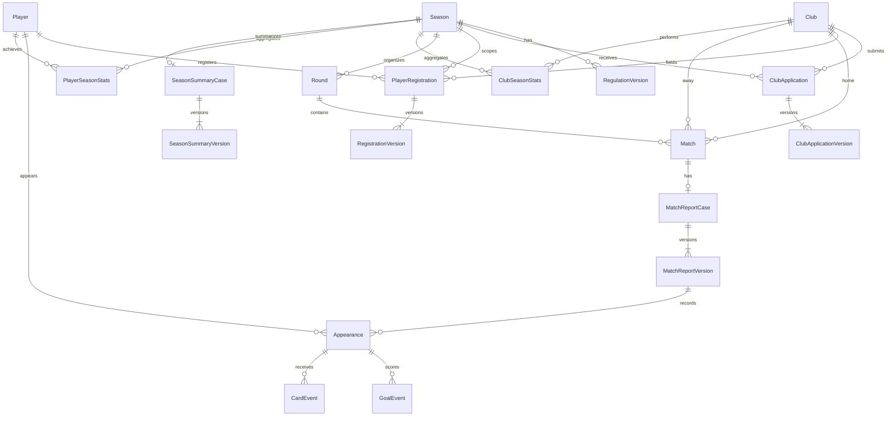

# Architecture and shared technical contracts

Owns approved stack, layering, time representation and final write authorization. Only the decisions below are selected; D079 owns module responsibilities/coordination, while D080 defines session transport/storage/expiration; D082 defines relational foundations and D087 the reference deployment; detailed internal interfaces, entity/field/index mappings and remaining operational/security contracts still await design. See [open work](../open-decisions.md).

### D001 - Modular, layered monolithic backend

**Confirmed policy.** [Approval, source and rationale](../../../docs/adr/0001-modular-layered-backend.md#d001-english-evidence).

- **Source:** O12; CN-01-CN-04, PDF p.26; centralized data constraint in §1.2.6.1; three-member team and source project plan in §1.5 pp.50-52.

- **Decision:** One backend deployed as a single unit, organized into business modules with clear request-handling, business-processing and data-access responsibilities; one centralized relational database.

### D002 - Approved technology stack and API style

**Confirmed policy.** [Approval, source and rationale](../../../docs/adr/0002-approved-technology-stack.md#d002-english-evidence).

- **Source:** O12; CN-01-CN-04, PDF p.26; Q2 confirmation. The selection principle prioritizes technologies the team has practiced, subject to course constraints. The confirmation does not establish individual members' experience or additional course constraints.

- **Decision:** Frontend: React + TypeScript. Backend: NestJS + TypeScript. Database: PostgreSQL. ORM: Prisma ORM. API style: REST API. Architecture: Modular Monolith combined with Layered Architecture, consistent with [D001](architecture.md#d001---modular-layered-monolithic-backend).

- **Consequences:** Chapter 3 design and subsequent implementation planning use this approved stack. Module ownership follows [D079](#d079---backend-module-ownership-and-synchronous-coordination); PostgreSQL schema, Prisma mappings, detailed internal interfaces and REST contracts must be designed consistently with it.

### D024 - UTC instants and a single Vietnam display/input time zone

**Confirmed policy.** [Approval, source and rationale](../../../docs/adr/0006-utc-instants-and-vietnam-time-zone.md#d024-english-evidence).

- **Source:** O03/O12 and cross-cutting O07/O08; TT-04, PDF p.19; time-related scheduling/registration/regulation/delegation requirements. This is an explicitly confirmed v2 design policy, not a time zone specified by the PDF.

- **Decision:** Store and compare exact instants using UTC. Use Asia/Ho_Chi_Minh consistently for time entry and display across the system, including match schedules, registration deadlines, regulation/delegation effectivity and activity history. Clearly label the time zone and do not automatically switch to the user's device time zone.

- **Date-only values:** Preserve dates without a time component, such as dates of birth and U21 birth-date cutoffs, as calendar-date values without time-zone conversion. This does not select the actual seasonal cutoff dates or deadline values.

### D030 - Recheck current session and authority at the final decision point of writes

**Confirmed policy.** [Approval, source and rationale](../../../docs/adr/0007-final-authorization-check-for-writes.md#d030-english-evidence).

- **Source:** O07/O08/O12; BM-01/BM-02 and CN-02, PDF pp.23/26; AT-02/AT-03, p.32; [D007](../use-cases/administration.md#d007---invalidate-sessions-after-permission-changes-or-account-locking)/[D020](access-control.md#d020---terminate-delegation-permanently-when-required-eligibility-is-lost)-[D023](access-control.md#d023---explicit-delegation-startend-instants-with-an-exclusive-end).

- **Decision:** For internal write operations, check permission when receiving the request and recheck the current session, authority and validity period at a final decision point inside the transaction before successfully recording the change. Starting with valid permission is insufficient if the session/authority is no longer valid at that final point.

- **Synchronization:** [D084](#d084---revision-checks-idempotent-commands-and-targeted-transaction-locks) owns the approved revision/idempotency/Read Committed locking and retry policy.

- **Failure and consistency:** If the final check fails, reject and roll back that business transaction without partial business data, statistics or workflow-state changes. Permission revocation and concurrent writes must have a consistent order so an old permission check cannot write past a revocation already in effect. Previously valid completed operations remain unchanged; revocation does not undo them retroactively.

- **Boundary example:** A request received at 11:59:59 using authority expiring at 12:00 must fail if its final authorization check occurs at 12:00:01. The interval boundary is as confirmed in [D023](access-control.md#d023---explicit-delegation-startend-instants-with-an-exclusive-end).

### D079 - Backend module ownership and synchronous coordination

**Status:** CONFIRMED by the Team Leader, Q79 option A and the full proposed package. [Approval and rationale](../../../docs/adr/0001-modular-layered-backend.md#q79---module-ownership-and-coordination).

| Module | Owned responsibilities |
|---|---|
| Identity & Access | UC01-UC04; accounts, sessions, permissions, assignments and delegation |
| Season & Regulations | UC05-UC06; seasons, regulation versions, closure/reopening |
| Registry & Registration | UC07-UC11; club/player masters, registration and transfers |
| Scheduling | UC12-UC15; stadiums, fixture schedules, adjustments and postponement |
| Match Results | UC16-UC19; reports, appearances, events, result confirmation/correction |
| Statistics & Reporting | UC20/UC22; standings, achievements, ranking resolutions and season summaries |
| Public Queries | UC21/UC23 and Dashboard; permitted read aggregation |
| News | UC24-UC25; content, publication versions and withdrawal |

- **Write ownership:** A data group has one business module responsible for validating and changing it. Other modules call its provided functions rather than writing its data to bypass rules.
- **Synchronous coordination:** Coordinate use cases through explicit internal calls in the single backend. No message broker or distributed-event mechanism is required by this design.
- **Transaction boundary:** A use-case application layer coordinates changes requiring consistency in one PostgreSQL transaction, including result confirmation/correction, statistics and history under D030/D063. Any failure rolls back the complete operation.
- **Dependencies:** Keep use-case orchestration separate from component business functions to avoid circular dependencies. Match Results provides valid result data; Statistics & Reporting calculates from that basis; orchestration completes the consistent operation. Exact internal interfaces/dependency details remain for technical design.
- **Read consistency:** Public Queries/Dashboard reuse the approved statistical results and publication rules rather than calculating a separate standings/achievement interpretation.
- **Shared support:** Media, Audit and Data Exchange support the owning modules without taking over their business authority/validation. Use one PostgreSQL with Prisma and retain the approved layered responsibilities. This adds no independently deployed service, library or infrastructure selection.

### D080 - PostgreSQL server-side sessions with protected cookies

**Status:** CONFIRMED by the Team Leader, Q80 option A and its full proposed package. [Approval and rationale](../../../docs/adr/0019-postgresql-cookie-sessions.md).

- **Server-side state:** PostgreSQL stores the account association, creation/activity/expiration times and revocation state. The browser holds only a random opaque session token, not business authority claims used to decide access. Store a hash of the session token rather than a directly reusable token.
- **Cookie/transport:** Use HttpOnly and SameSite=Lax cookies, with Secure on the HTTPS deployment. Do not store the token in localStorage/sessionStorage. Successful login creates a new session token.
- **Deployment origin:** Serve frontend and REST API through the same origin, with an API path such as /api. D087 subsequently selects Caddy for the reference deployment; no hosting provider is selected.
- **CSRF:** Protect state-changing browser requests with CSRF tokens and appropriate origin validation; SameSite is an additional layer, not the entire defense. Detailed contracts must cover login/logout too.
- **Expiration:** Server-enforced expiration is 30 minutes without a valid authenticated internal request, or 8 hours from login, whichever occurs first. There is no remember-me option in the first version.
- **Concurrent sessions/logout:** Permit multiple sessions for an account across browsers/devices. Ordinary logout revokes the current session and clears its cookie. D007/D022/D039/D076 events still invalidate all applicable sessions.
- **Current authority:** Session validity alone grants no business action. Check current role, season, delegation and business state, retaining final in-transaction permission/session validation under D030.
- **Feedback:** Expiration requires login again; account/permission-triggered invalidation uses the D007 notice. Do not automatically replay writes that could execute twice.
- **Remaining contracts:** Exact token generation/hash representation, schema, cookie settings for environments, CSRF/bootstrap endpoints, error/concurrency/cleanup contracts remain to be elaborated. No JWT/refresh-token mechanism, Redis or session library is selected by this decision. Password hashing/lifecycle is separately selected by [D081](../use-cases/administration.md#d081---password-hashing-and-managed-credential-lifecycle).

### D082 - Relational identity, version and snapshot foundations

**Status:** CONFIRMED by the Team Leader, Q82 option A and its full common package. [Approval and rationale](../../../docs/adr/0021-relational-identifiers-and-snapshots.md).

- **Identifiers:** Use backend-generated UUID v4 technical identifiers for independently identified entities, stored as PostgreSQL uuid and represented as strings in APIs. Business codes remain separate, unique/stable/nonreusable under D058; relationships do not use editable descriptive fields as keys.
- **Normalization:** Represent core seasons, clubs, players, registrations, matches, report versions, appearances, goals and cards with explicit relational tables and appropriate foreign keys/constraints. Do not replace complete core profiles/reports with JSON documents.
- **Cases and versions:** Versioned business workflows have a stable case and numbered content versions within it. Content/approval links identify the exact version rather than an implicitly mutable latest record.
- **Selective snapshots:** Use JSONB for the already-required historical snapshots and before/after audit payloads, with defined validated structures. Keep relationships, states, effective intervals and fields needed for business constraints in explicit columns/tables.
- **Types:** Use timestamptz for exact instants and date for birth dates/U21 cutoff dates under D024. Counts, goals, minutes and shirt numbers use integers with their applicable constraints.
- **Preservation:** Block master deletion or destructive cascading deletion that loses used registrations, results or history. Draft/temporary-data cleanup has a separate scope and cannot remove submitted/approved versions.
- **Design boundary:** Detailed entity/field/index/foreign-key mappings remain design elaboration under these foundations and the approved domain rules; this is no migration, code implementation or whole-package approval.

## Derived relational model map

This is an initial design map derived from approved D001-D082, not another business decision or a completed physical schema. Names below identify logical entity families; precise table/column/index mappings remain to be elaborated. Cardinalities are read with draft completeness and approval-milestone constraints in the owning UC documents. Statistical projection storage/recalculation follows [D083](../use-cases/results.md#d083---stored-official-statistics-with-full-season-recalculation).

| Owner under D079 | Entity families and relationships | Rule basis |
|---|---|---|
| Identity & Access | One personal account per person; an account has many sessions and seasonal role assignments; separately scoped permission grants; delegation proposal versions and granted authority remain distinct | D003-D041, D076, D080-D081 |
| Season & Regulations | A season has many immutable regulation versions, their registration windows and applicable goal/card catalog entries; preserve cancellation/replacement and lifecycle history | D042-D054, D072, D074, D076 |
| Registry & Registration | Shared Club/Player masters; one club-season application case with versions; player registrations linked to player/club/season and their versioned playing intervals/verification basis; preserve prior-transfer dependencies | D035-D036, D055-D059, D075 |
| Scheduling | Stadium master; season rounds and stable matches with home/away clubs; schedule versions and entries; versioned adjustment/postponement requests with affected items | D060-D062, D067 |
| Match Results | One report case per match with versions; appearances/goals/cards belong to the report version; current Official Result refers to a confirmed report version, while pending corrections do not replace it | D047-D049, D063-D065 |
| Statistics & Reporting | ClubSeasonStats and PlayerSeasonStats derived from current Official Results under D083; ranking-resolution cases/versions and ordered clubs; one season-summary case with immutable confirmed versions and selective source snapshots | D066, D070-D073, D083 |
| Public Queries | Reads permitted source records and shared statistical interpretation; Dashboard is not another authoritative competition dataset | D032-D033, D068, D079 |
| News | Each news item belongs to one season and has content versions, an explicitly permitted current publication and retained withdrawal/publication history | D077 |
| Shared support | Media metadata/current club/player references plus environment-selected durable file/object storage under [media policy](media.md#environment-specific-media-storage); actor-linked audit entries with selective JSONB; account/action-scoped command receipts; XLSX creates existing master entities without new approval bypasses | LOGO-01, D069, D078, D082, D084 |

### Core competition relationships

The diagram deliberately shows only the competition core; permission, schedule-version, media and publication families are described above and will be expanded in the detailed schema. It does not fix all draft nullability, uniqueness or physical deletion actions.

A scheduled match can exist before report entry; a MatchReportCase is created when report preparation starts, not by treating scheduling as result creation. Appearance/event completeness is required at the D064/D065 submission/confirmation milestones. The current official-version reference is distinct from the version-history relationships shown.

### D084 - Revision checks, idempotent commands and targeted transaction locks

**Status:** CONFIRMED by the Team Leader, Q84 option A and its full common package. [Approval and rationale](../../../docs/adr/0022-targeted-locks-and-idempotent-commands.md).

- **Optimistic revision:** Editable records/aggregates carry a technical revision separate from D082 content-version numbering. Mutations provide the revision read; stale revisions are rejected for reload/review rather than silently overwriting another writer.
- **Submitted content:** Approval/confirmation targets the exact submitted content version and still-valid basis. Changed prerequisites cause a conflict/review, not automatic approval of newer content.
- **Idempotency:** Critical commands, including approvals, result confirmation/correction, transfers, season closure/reopening and import commit, carry a unique request key. Persist a receipt in PostgreSQL in the same transaction as the business change.
- **Receipt semantics:** For 24 hours, the same account/action/key and content return the recorded outcome without a second execution; key reuse with changed content is rejected. Validate current session and access before returning stored data. After receipt retention expires, business state/version constraints still prevent repeated sporting operations.
- **Final authorization/time:** Writes and permission changes/revocation use consistent synchronization under D030. Recheck actual validity at the final decision point, including after waiting for locks.
- **Isolation/locks:** Use Read Committed with explicit targeted synchronization: season locks for D083 result/statistics transactions; relevant shared club/stadium resources for cross-season scheduling; player/squad resources for interval/limit checks; authorization-change coordination plus separate bootstrap/last-administrator guards. Specify one lock-acquisition order and retain database constraints as final protection.
- **Bounded retry:** At most three total server execution attempts for transient transaction errors known to have rolled back, with all checks repeated. Do not automatically retry authorization, invalid-data or stale-revision errors. If commit outcome is unknown, look up the receipt before considering another execution.
- **Remaining contracts:** Exact guard rows/lock ordering, indexes, receipt key/content canonicalization/response filtering/cleanup, timeout/error mapping and per-command matrix remain technical elaboration. This selects no Redis/broker, implementation or blanket Serializable policy.

### D085 - Shared REST transport and response contract

**Status:** CONFIRMED by the Team Leader, Q85 option A and its full common package. [Approval and rationale](../../../docs/adr/0023-shared-rest-contract.md).

- **Routes/methods:** Prefix routes with /api/v1. GET reads; POST creates or executes explicit business commands; PATCH edits allowed fields. Submit/approve/confirm/withdraw actions have explicit endpoints; a generic status PATCH cannot bypass workflows.
- **Values:** Use JSON UTF-8 and camelCase fields, string UUIDs, ISO 8601 UTC instants ending in Z and YYYY-MM-DD date-only values under D024/D082.
- **Validation:** Per-operation server-side field allowlists reject unknown fields and invalid types/values. Do not expose one unrestricted update payload across roles/states.
- **Lists:** Use page/pageSize with default 20 and maximum 100, return total item count, and allowlist filters/sorts with deterministic ordering. D066 sporting rank/tie rules still apply.
- **Concurrency/tracing:** Mutations identify required technical revisions/content versions and D084 idempotency keys. A requestId traces one HTTP attempt and is not its business idempotency key.
- **Responses:** JSON successes use { data, meta?, requestId }; failures use { error: { code, message, details? }, requestId }. Codes are stable; details identify permitted validation fields or XLSX rows/columns when appropriate. Never expose passwords, hashes, SQL or stack traces.
- **HTTP mapping:** 200/201 success/creation; 400 invalid input; 401 invalid/missing session; 403 valid session but disallowed; 404 absent/non-discoverable resource; 409 revision/state/data/idempotency conflict; 413 oversized file; 415 unsupported media type; 429 request throttling; 500 unexpected failure; 503 temporary unavailability. Failed business actions do not return HTTP 200.
- **Access/files:** Classify public/internal endpoints and filter fields on the server. Media/XLSX downloads return file bytes with the appropriate content type, outside the JSON envelope; error handling must preserve access boundaries.
- **Remaining work:** Per-UC route/DTO/permission/error/lock details are derived technical contracts, with unspecified source-reference/field limits tracked as open work. This selects no generated client, validation/HTTP library or implementation.

### D086 - React SPA tooling and shared UI approach

**Status:** CONFIRMED by the Team Leader, Q86 option A and its full common package. [Approval and rationale](../../../docs/adr/0024-react-frontend-tooling-and-ui.md).

- **Tooling:** Build the React/TypeScript SPA with Vite and React Router. Use Ant Design for standard components and CSS Modules for layout/league-specific styling. Select compatible versions with the development environment; this creates no code or dependency installation now.
- **Language/time:** The first-version UI is Vietnamese, preserving appropriate proper club/player names and terms. Context documentation stays English-only. Display/input uses D024, not automatic device-zone switching.
- **Navigation:** Public screens cover Dashboard, club/player profiles, schedule/results, standings/achievements and news. Internal screens expose authorized business functions in one application, with relevant season selection for multi-role users. Global account administration does not require a seasonal business role.
- **API/state:** Use one Fetch-based API layer for cookies/CSRF, D085 replies/errors/pagination and D084 command keys. Use React state/hooks/context for UI/session state; no separate state/cache library is required by this package.
- **Interactions:** Provide Loading/Empty/Error, field errors, result feedback and important-action confirmations. Approval views identify preparers, version and required reasons rather than offering an unexplained status toggle.
- **Conflicts/session loss:** On 409 preserve current input for review instead of overwriting. On loss of internal session validity, clear internal in-memory data and require login under D080/D081; do not restore that data to another account.
- **Visual/access consistency:** Share visual tokens, tables/forms and managed media/fallback components under TT-02/D068. Frontend access checks support navigation; the backend remains authoritative. Exact routes/layout details are derived from the existing UCs, not new actors or UCs.

## Derived frontend screen map

Derived from D068/D074-D086 and the owning UCs, this is a navigation/layout design map rather than implemented screens or new feature Specifications. Browser routes below differ from /api/v1 API routes. Exact artwork and component layout remain design elaboration under D086 and existing quality criteria.

| Area/browser route family | Screens and actions | Governing scope |
|---|---|---|
| / and /seasons/{seasonId} | Public season selection and D068 overview | Published/permitted data; no separate internal work-queue dashboard |
| /seasons/{seasonId}/clubs and /players | Searchable/paginated lists and club/player details | UC23; D032, seasonal snapshots, LOGO-01/D069 |
| /seasons/{seasonId}/schedule and /matches | Published fixtures, explicit postponed state, match details and Official Results | UC15/UC21; D063/D067 |
| /seasons/{seasonId}/standings and /statistics | Shared ranks, scorers/clean-sheet leaders and full-list navigation | UC20 public output/UC23; D066/D070/D083 |
| /seasons/{seasonId}/news | Current published news list/detail | UC25; D077 |
| /login and /change-password | Login and restricted required-password-change state | UC01; D080/D081 |
| /workspace/accounts and /audit | Account/permission/session-related administration and audit search | UC03/UC04; global rights and redacted fields |
| /workspace/seasons | Create Season action and assigned-season management/closure/reopening | UC05; D074/D076 |
| /workspace/seasons/{seasonId}/regulations | Version drafts, exact submitted-version review and approvals/effectivity | UC06; D042-D054/D072 |
| /workspace/clubs and /players | Authorized master profiles/media and D078 exchange entry points | UC07/UC09; separately granted master rights |
| /workspace/seasons/{seasonId}/registrations | Club applications, player registrations, eligibility reasons, transfers and corrections | UC08/UC10; UC11 inline validation, not an independent public service |
| /workspace/stadiums and /workspace/seasons/{seasonId}/schedules | Stadium masters, initial schedule drafts, adjustment/postponement requests and approvals | UC12-UC14; D060-D067 |
| /workspace/seasons/{seasonId}/results | Report editing, appearance/event/referee basis, confirmation and correction review | UC16-UC19; UC20 is internal recalculation, not a manual statistics editor |
| /workspace/seasons/{seasonId}/reports | BM5 previews/XLSX exports, playoff ranking-resolution cases and versioned summaries | UC22; D070-D073/D078 |
| /workspace/seasons/{seasonId}/news | Draft/revision, self-publication, withdrawal and retained history | UC24; D077, including its Closed-season exception |

The internal shell is a permission-aware menu/workspace, not an additional mandatory Dashboard. Components reuse the same metadata, date/time and API adapters; no client-maintained authoritative standings or permission store is introduced. All screen groups retain the source empty/error/unauthorized/confirmation paths, and ineligible self-approval remains server-rejected even if a client route is accessed directly.

### D087 - Docker Compose reference deployment

**Status:** CONFIRMED by the Team Leader, Q87 option A and the full common package, with the explicitly approved optional Supabase Storage amendment. [Approval and rationale](../../../docs/adr/0001-modular-layered-backend.md#q87---docker-compose-reference-deployment).

- **Reference topology:** One Linux host runs the single NestJS backend, PostgreSQL and Caddy through Docker Compose with an internal service network. Caddy serves the React production build and reverse-proxies /api/v1 to the backend under the same browser origin. This retains the modular layered monolith; no hosting provider or purchased domain is selected.
- **HTTPS:** Use valid HTTPS for deployment and D080 Secure cookies. A local HTTPS acceptance setup must establish appropriate certificate trust to exercise those controls; development configuration is separate. Persist Caddy certificate state across container replacement.
- **Durability:** PostgreSQL data uses persistent volumes outside the repository/executable area. Media follows the single owning [environment-specific storage policy](media.md#environment-specific-media-storage), including local persistent volumes or the permitted Internet alternative. Application/container restart or replacement must preserve persisted data. Persistence alone does not establish backup/recovery.
- **Environment and secrets:** Separate development, test and acceptance configuration/data. Keep credentials and secrets outside Git; committed configuration examples contain placeholders only. Initial administrator setup remains D008's server CLI, not default credentials or a public bootstrap endpoint.
- **Repeatable operation:** Document prerequisites, build, migration, start and health verification. Pin compatible versions when establishing the toolchain. Migrations must preserve existing data rather than silently reset/delete it. Exact versions, host sizing and operation scripts remain elaboration, not selected products in this decision.
- **Boundaries:** Core business remains independent of external football APIs. The storage amendment does not select Vercel, Render, Supabase Database or Supabase Auth, change D080 authentication, or authorize current API integration/code implementation. Backup/restore follows D088 below; timed-job mechanisms follow D089 below and detailed operational configuration remains open under existing quality thresholds; no whole-v2 or Phase completion is implied.

Technical references: [Docker Compose application model](https://docs.docker.com/compose/intro/compose-application-model/), [Docker volume persistence](https://docs.docker.com/engine/storage/volumes/) and [Caddy automatic HTTPS](https://caddyserver.com/docs/automatic-https). These explain the selected mechanisms, not additional project policy.

### D088 - Coordinated backup sets and controlled restore

**Status:** CONFIRMED by the Team Leader, Q88 option A and the full proposed package ("Tôi chọn A."). [Approval and rationale](../../../docs/adr/0001-modular-layered-backend.md#q88---coordinated-backup-and-restore). This elaborates D087/LOGO-01/D069 and BM-07; it does not establish implementation or acceptance.

- **Backup unit:** One complete set contains a PostgreSQL custom-format pg_dump archive, the actual referenced media files/objects from the configured storage, and a manifest with set identifier, timestamp, schema/application versions and image inventory/checksums. Restore PostgreSQL through pg_restore. No simultaneous local/remote operational media stores are required.
- **Consistent boundary:** Enter write-maintenance mode, stop admitting new writes and wait for in-flight operations to complete before establishing the backup point. This covers business writes, media replacement/removal and background writers. Reads may continue where safe, with clear maintenance feedback. Publish a set as successful only after database, media and manifest are complete and verified.
- **Execution and failure:** Automatically back up at least once every 24 hours, with additional operator-initiated runs before migrations or important changes. Prevent overlapping runs. Record failed runs and notify the operator; permit rerun. Failed/incomplete sets do not replace good sets or count toward retention. The scheduling mechanism is owned by [D089](#d089---periodic-jobs-and-overdue-regulation-activation).
- **Storage and retention:** Keep backup sets separate from live data directories, Git and public web paths, with restricted access. Internet deployments require a copy outside the application host. Retain at least the 7 most recent complete sets. Cleanup must preserve image content required by retained sets. Manage credentials separately; do not include them in manifests/logs. Exact destination, paths and provider-specific transfer/configuration are subsequent technical elaboration, not a selected new service.
- **Restore authority and procedure:** Restore through an operator-controlled server procedure/command, not a public restore API/page. Keep write maintenance active; restore database and media from the same set. Check schema compatibility, relationships, image references and important business functions before reopening. Invalidate restored login sessions and require fresh login rather than reviving old sessions.
- **Verification and limits:** Rehearse on a separate environment with the selected storage profile's season data/media, demonstrate the existing 30-minute full-season recovery threshold and test incomplete/corrupt media sets. Recovery returns to the selected backup point; no point-in-time-per-transaction recovery or zero-loss promise is added. Existing BM-07 thresholds remain unchanged. Detailed scripts, checks and runbooks are implementation-planning work; whole-v2 and Phase approval remain pending.

Technical references: [PostgreSQL pg_dump](https://www.postgresql.org/docs/current/app-pgdump.html) and [pg_restore](https://www.postgresql.org/docs/current/app-pgrestore.html) describe the selected database tools. [Supabase backup scope](https://supabase.com/docs/guides/platform/backups) explains why actual Storage objects must be included separately. D088's write-maintenance boundary coordinates database and media; a database dump alone does not establish that cross-store boundary.

### D089 - Periodic jobs and overdue regulation activation

**Status:** CONFIRMED by the Team Leader, Q89 option A and the entire proposed package ("Tôi chọn A."). [Approval and rationale](../../../docs/adr/0001-modular-layered-backend.md#q89---periodic-jobs-and-overdue-activation). This owns scheduling/technical recovery; [D051](../use-cases/registration.md#d051---controlled-cancellation-replacement-and-activation-of-waiting-regulations) retains ownership of regulation cancellation/replacement and business-incompatible activation.

- **Execution model:** Use @nestjs/schedule within the existing backend for business jobs, and Linux systemd timers for operator-run backup commands under D088. Do not add Redis, a message broker or an independently deployed worker service. Exact runtime/package versions and timer/service definitions remain toolchain elaboration.
- **Due-work discovery:** Scan waiting regulation versions every 1 minute while the backend runs. At backend startup, discover overdue work from persisted PostgreSQL state and catch up. Reuse owning business services/transactions rather than maintaining separate timer-only business rules.
- **Time correctness:** Preserve the approved effective instant separately from actual processing time. A late timer does not move effectivity to its execution time or rewrite historical decisions. Before an operation relying on current regulations, check for due versions and resolve activation using the appropriate shared lock/transaction boundary; do not commit using stale regulations merely because the timer has not run. Reads must identify the correct effective basis or return an explicit error if it cannot safely be resolved, rather than label the old basis as current.
- **Business versus technical failure:** Business incompatibility follows D051's terminal Activation blocked outcome, retaining current regulations, freeing the waiting slot and requiring a new proposal. Technical failures roll back without declaring activation success or business incompatibility. Keep approved content and retry on a later scan or operator-command invocation. While unresolved, block dependent operations rather than silently use the wrong basis. This does not reopen the approved future-version cancellation window or authorize changing an approved effective instant.
- **Concurrency and maintenance:** Coordinate execution/recorded state through PostgreSQL locks and transactions; repeated or concurrent job/request execution must not duplicate activation effects/history. All background writers obey D088 maintenance and its drain boundary. Record run/processing times, outcome and errors; persistent failures must be visible to the operator. No email/SMS service is selected.
- **Expiry versus cleanup:** Enforce session, delegation and other time limits when used, including final D030 authorization. Cleanup timing neither prolongs authority nor revives sessions. Remove only eligible technical data, preserving D084's command-receipt retention and approved business/audit history. No new audit-deletion or historical-data retention period is selected.
- **Backup scheduling:** systemd timers invoke the D088 backup procedure on the host, with missed-run checks after host recovery. Prevent overlapping runs; record failures for operator remediation/rerun. Configure the run time per environment to meet at least one backup every 24 hours during operation; downtime is not a successful backup. Exact timer catch-up/retry parameters, alert presentation and cleanup schedules remain derived technical configuration, without relaxing these rules.
- **Verification:** Exercise restart catch-up, a delayed/failed timer, a business-incompatible version, transient technical failure, concurrent job/request processing, write maintenance and expiry before cleanup. Retain the existing D084 per-transaction bounded-retry policy; later scheduled recovery is not permission for an unbounded synchronous request retry loop. No Phase completion or whole-v2 approval is implied.

Technical references: [NestJS task scheduling](https://docs.nestjs.com/techniques/task-scheduling) and [systemd timers](https://www.freedesktop.org/software/systemd/man/latest/systemd.timer.html). Scheduler facilities do not replace the approved persisted-state, authorization and consistency checks.
